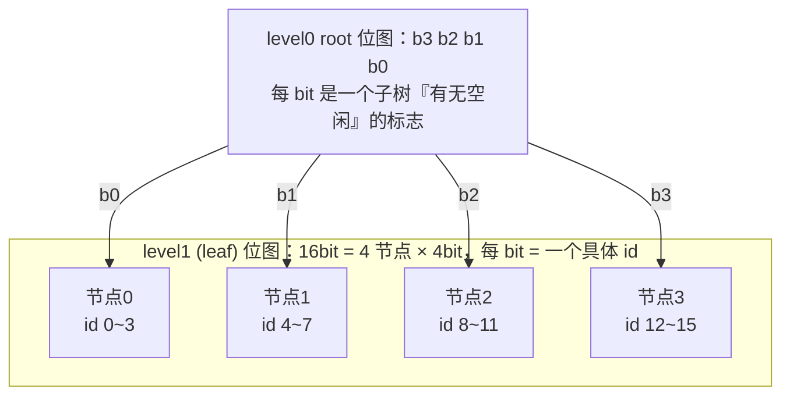
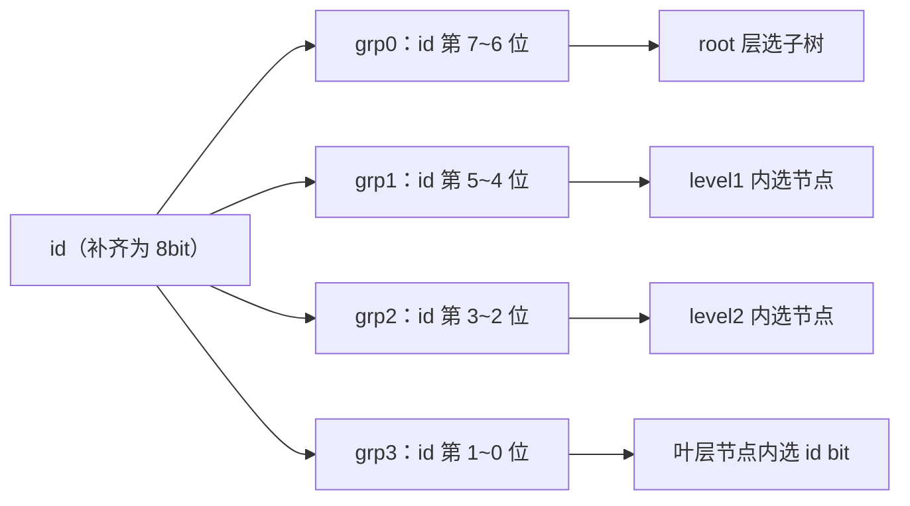
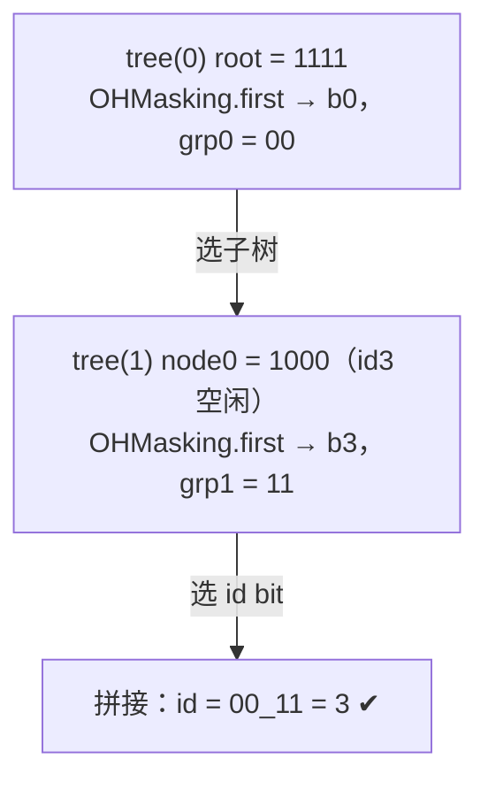
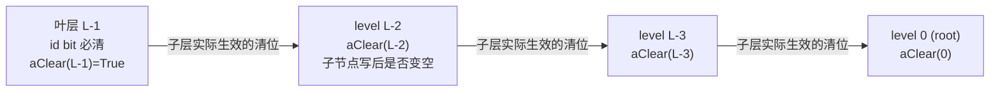
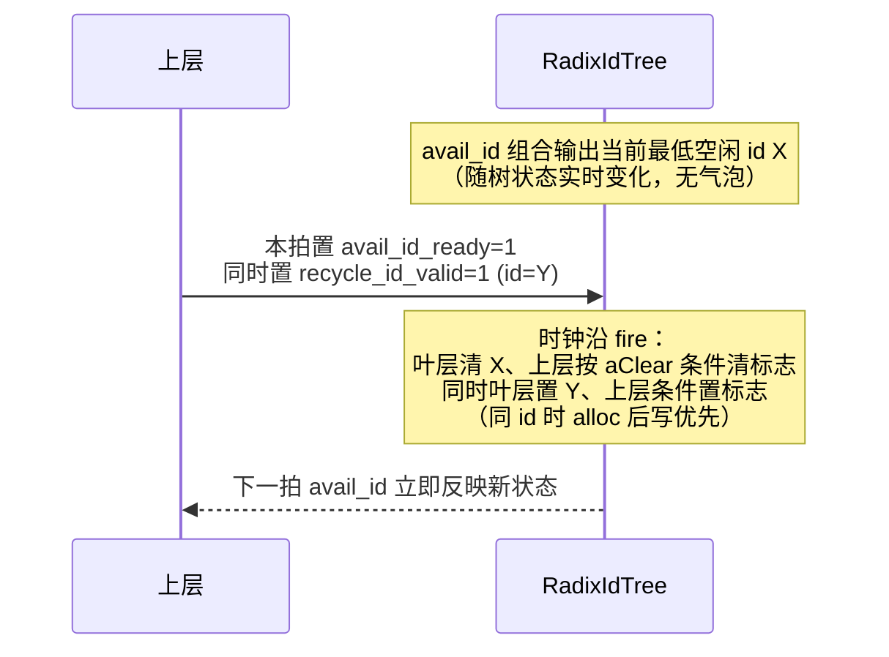

# RadixIdTree 设计文档 —— radix-4 树形 ID 分配/回收管理器

> 代码：`src/main/scala/radix_tree.scala`　|　测试：`src/test/pyuvm/radix_tree/`
> 交互演示：`doc/radix_tree_interactive.html`
> 用途：替代整条 bitmap 扫描式的 id 管理（如 bitmap 取最低 1 分配 slot id 的方案）

## 1. 概述

`RadixIdTree(id_num)` 维护 `id_num` 个 id 的分配状态，对外提供两个 Stream 接口：

- **avail_id**（master Stream）：恒给出当前**最低的空闲 id**，握手成功即弹出（完成分配）；
- **recycle_id**（slave Stream）：回收一个已分配的 id，无反压（当拍必接收）。

分配语义与"扫描整条 bitmap 取最低 1"完全一致，但查找逻辑深度从 O(id_num) 的
优先编码降为 O(log4(id_num))，寄存器开销约为 (4/3)×id_num bit。

## 2. 接口

| 信号 | 方向 | 宽度 | 说明 |
|---|---|---|---|
| `avail_id_valid/ready/payload` | master | 1/1/log2Up(id_num) | 当前最低空闲 id，握手即分配 |
| `recycle_id_valid/ready/payload` | slave | 1/1/log2Up(id_num) | 回收 id，ready 恒 1（无反压） |
| `avail_cnt` | out | log2Up(id_num+1) | 当前空闲 id 总数（组合输出，流控/调试用） |

参数约束：`id_num` 必须为 2 的幂且 ≥ 2。

## 3. 树形结构

### 3.1 层次与 bit 语义

radix-4 树，每节点 4 个子节点，层数 `L = ceil(log2(id_num)/2)`。
每层是一条扁平的**空闲位图寄存器**，但两种层的 bit 含义不同：

- **叶层**（第 L-1 层）：每个 bit 对应一个 id，**1 = 该 id 空闲**；
- **上层**（第 l < L-1 层）：每个节点 4 bit，每个 bit 是其一个子节点
  "子树内是否存在空闲 id" 的**标志位**（注意：不是逐 id 位图）。

以 `id_num = 16` 为例（L = 2）：



复位值：各层**有效位全 1**（全部空闲）；覆盖范围超出 `id_num` 的位恒为 0，
永不参与分配，也永远不会被 recycle 置位（如 `id_num=16` 时 root 恰好全有效；
`id_num=8` 时 root 的 b2/b3 恒 0）。

### 3.2 层次参数公式

```
idWidth   = log2Up(id_num)             // id 位宽
L         = ceil(idWidth / 2)          // 层数（radix-4）
idPad     = 2 * L                      // id 补齐到每层 2bit（idWidth 为奇数时最高位恒 0）
nodeW(l)  = 4                          // 每节点位宽（仅 id_num==2 时根即叶，为 2）
levelBits(l) = min(4^(l+1), id_num)    // 第 l 层位图总宽
validBits(l) = id_num >> 2*(L-1-l)     // 第 l 层有效位数
```

id 位段与层级的对应（从根到叶依次取 2bit，高位组在前）：

```
id 补齐为 idPad bit:  idp = 0...0 ## id
第 l 层组（该层选子节点用）:  grp(l) = idp[2*(L-l)-1 -: 2]
第 l 层节点索引（由更高位段决定）:  nodeIdx(l) = id >> 2*(L-l)
第 l 层节点在层位图中的 bit 基址:  base(l) = nodeIdx(l) << 2
```

例：`id_num = 256`，L = 4，id 的 8bit 被切成 4 组，每组控制一层选路：



| 层 | 位图宽 | 节点数 | 每节点含义 |
|---|---|---|---|
| level0 (root) | 4bit | 1 | 4 个子树的空闲标志 |
| level1 | 16bit | 4 | 各 4 个子节点的空闲标志 |
| level2 | 64bit | 16 | 各 4 个子节点的空闲标志 |
| level3 (leaf) | 256bit | 64 | 每 4bit 对应 4 个具体 id |

## 4. 分配（alloc）

### 4.1 组合译码路径（当前最低空闲 id）

从根到叶逐层，每层做三件事：

```
① 取节点:  node(l) = tree(l) >> base(l)      （截取 nodeW 位）
② 选最低:  oh(l)   = OHMasking.first(node(l))
③ 拼 id :  acc     = (acc << 2) | OHToUInt(oh(l))；base(l+1) 由 acc 低 2l 位决定
```

`avail_id.payload = acc`，`avail_id.valid = tree(0).orR`（根非空即有空闲）。
树空时 oh 全 0，payload 无意义但 valid=0 屏蔽。**分配为纯组合读出 + 单拍握手**。

**示意**（id_num=16，当前已分配 {0,1,2,4}，avail 应给出 3）：



### 4.2 握手后的状态更新（关键：上层是条件清位）

- **叶层**：无条件清选中的 1 个 id bit；
- **上层**：仅当子节点在本拍写完后变空，才清掉对应的父标志位；
  子节点仍有空闲则父标志保持 1。

沿用 4.1 的例子，alloc id=3 握手当拍：

| 层 | alloc 前 | alloc 后 | 规则 |
|---|---|---|---|
| leaf node0 | `1000` | `0000` | 叶层：无条件清 id3 |
| root b0 | `1` | `0` | 子节点变空 → 清标志 |
| root b1~b3 | `111` | `111` | 子树仍有空闲 → 保持 |

下一拍 avail_id = 4（node1 的最低空闲）。对照：若 alloc 的是 id=2
（node0 还有 id3 空闲），node0 = `0100` 非空，**root b0 保持 1** ——
这就是"标志位"与"逐 id 位图"的区别。

### 4.3 清位条件的自底向上递归（aClear）

L > 2 时上层清位依赖更下层的写入结果，须从叶向根逐层确定：

```
aClear(L-1) = True          // 叶层选中的 id bit 必被清（写入的"事实"）

第 l 层的清位条件 (l 从 L-2 到 0，自底向上):
  childAfter(l+1) = allocNode(l+1)
                  & ~(aClear(l+1) ? allocOh(l+1) : 0)   // 子层实际生效的清位
                  |  recOh(l+1)(同拍 recycle 命中同一子节点时计入)
  aClear(l)       = (childAfter == 0)
```

注意：上层节点 speculative 清掉的位是**标志位**，只有子层确认真的变空
（`aClear(l+1)`）才允许该清位生效——递归到叶层的"id bit 必清"是整条链的根基。

以 L=4 为例的信息流（单拍内组合完成，箭头表示依赖方向）：



## 5. 回收（recycle）

按 id 各层生成节点内 one-hot 掩码 `recOh(l) = 1 << grp(l)`，写入规则：

- **叶层**：无条件置回选中的 1 个 id bit；
- **上层**：仅当子节点**原本为满**（标志位为 0，即 `recNode(l+1) == 0`）时
  才置父标志位；子节点本就有空闲则标志位已为 1，无需操作。

**示意一**：node1 尚有空闲时回收 id=7 —— 只动叶层：

| 层 | recycle 前 | recycle 后 | 规则 |
|---|---|---|---|
| leaf node1 | `0110`（5,6 空闲） | `0111` | 无条件置 id7 |
| root b1 | `1` | `1` | 子节点本就有空闲 → 不动 |

**示意二**：全满状态回收 id=9 —— 各层标志全部翻转为"有空闲"：

| 层 | recycle 前 | recycle 后 | 规则 |
|---|---|---|---|
| leaf node2 | `0000` | `0100` | 置 id9 |
| 中间层标志 | `0` | `1` | 子节点原为满 → 置标志 |
| root b2 | `0` | `1` | 子树原为满 → 置标志 |

下一拍 avail_id = 9。

协议正确（只回收已分配 id）时该条件恒安全：回收某节点内的 id 说明该节点
此前无空闲。即使重复回收，叶层重复置 1 也无硬件危害。

## 6. 时序与协议约定

- 全程单拍：alloc 握手当拍生效，recycle 当拍生效，无流水、无反压；
- **同拍 alloc + recycle 同一 id**：alloc 优先（写序为先 `|set` 后 `&~clr`），
  该 id 视为被分配走；
- **同拍 alloc + recycle 不同 id**：完全并行支持，二者路径相交时
  （同层同子节点）`aClear` 已计入 recycle 置位，不会产生悬空/幽灵标志；
- **协议假设**：只回收已分配且未重复回收的 id；回收未分配 id 属于协议违规，
  硬件不会死锁，但状态语义不再可预测。

同拍 alloc + recycle 的握手时序：



## 7. 与 bitmap 方案的对比

### 7.1 资源与时序总览

| 项目 | bitmap（如 slot_bitmap_proc） | RadixIdTree |
|---|---|---|
| 寄存器 | id_num bit | ≈ (4/3)×id_num bit |
| 分配延迟 | O(N) 宽运算（(x-1) 借位链 + 宽优先编码），常需多拍流水 | **恒定单拍**，组合深度 O(log4 N) |
| 回收延迟 | O(1)（置 bit） | O(log4 N)，各层并行小逻辑 |
| 空闲计数 | CountOne over N bit | CountOne over 叶层 N bit（相同） |
| 满/空判断 | N bit 归约 | root 4bit 非零（浅） |
| 每拍可分配数 | 1（或批量位图流水吐出多个） | 1 |
| 功耗 | 宽组合逻辑每拍翻转 | 只触动一条路径的小逻辑 |

### 7.2 核心优势

1. **确定性单拍延迟**：bitmap 流水扫描（按 segment 切、FIFO 缓冲）延迟随 N 增长
   且有排队；radix 恒定 1 拍，适合"来一个请求发一个 id"的稳态流；
2. **回避宽借位链**：bitmap 取最低 1 的经典写法 `(x & ~(x-1))` 里的
   **N bit 减法器**是随 N 线性恶化的进位/借位链，radix 把"找最低"拆成
   L 级 4bit 优先译码，没有宽运算；
3. **满/空与流控信号极浅**：valid 只看 root 4bit；
4. **功耗友好**：每次分配只翻转一条根→叶路径上的少数门。

### 7.3 bitmap 仍然占优的场景（务必评估）

- **批量分配**：`slot_bitmap_proc` 一拍输入上千 bit 的位图，可流水吐出
  成百个连续 id；radix 方案**每拍只能发 1 个 id**。若业务是"把大位图
  批量转成 id 流"，radix 带宽差 1~2 个数量级。
  对策：k 路并行 walk + 仲裁（各 walk 落在不同子树时无冲突），或
  批量场景保留 bitmap、radix 只做稳态单粒度分配；
- **极端面积敏感**：1.33 倍寄存器开销在 id_num 很大时是实打实的 flops。

### 7.4 规模扩大带来的时序风险

| 风险点 | 随 N 增长 | 开始显著的规模 | 缓解手段 |
|---|---|---|---|
| alloc 逐层**串行**译码（每层：动态移位 + 4bit 优先译码 + 拼接） | L 级串联，O(log4 N) | N≥256 进入中速区；N≥4K 必须打拍 | walk 分级打拍（2 拍分配）；换更大 radix 减层 |
| 动态移位器 `tree(l) >> base` | 每层桶形移位深度 ~log2(levelBits(l)) | N≥1K | 每层改存 **Vec[节点寄存器]** 按 nodeIdx 索引（2l bit 地址的 mux），消除宽移位 |
| aClear 自底向上递归链 | L-1 级串行小逻辑，叠在寄存器 D 端 | N≥4K | 与 walk 打拍线合并；或每节点本地预计算"仅 1 bit 空闲" |
| avail_cnt = CountOne(叶层 N bit) | 加法树 O(log N)，且是组合输出，会串进下游路径 | N≥1K | 寄存一拍输出（流控容忍 1 拍旧值）或仅调试用可删 |
| recycle 各层置位掩码 | 各层**并行**，不串行 | 影响小 | — |

**fmax 量级预估**（中档 FPGA，综合后 LUT 级数折算，仅供方向参考）：

| id_num | 层数 L | alloc 关键路径估计 | 可达 fmax 量级 |
|---|---|---|---|
| 64 | 3 | ~10-12 级 LUT | 350MHz+ |
| 256 | 4 | ~16-20 级 | 250~300MHz |
| 1024 | 5 | ~20-28 级 | 180~250MHz |
| 4096 | 6 | ~28-36 级 + 宽 CountOne | 120~180MHz |

### 7.5 规模化改造路径（按需启用）

1. **换更大 radix**：radix-8/16 同时**减少层数和寄存器开销**
   （开销 = N/(r-1)：r=4 → 33%，r=8 → 14%，r=16 → 7%），节点扫描放宽到
   8/16bit 后 OHMasking/OHToUInt 仍很浅。**N≥4K 时首选 radix-8**；
2. **walk 分级打拍**：前 L/2 层、后 L/2 层各一级寄存器，分配变 2 拍。
   注意 avail_id 是"预占建议"，fire 后需要重算——可在打拍级上加
   fire 旁路（本拍清除结果组合前递），避免气泡；
3. **节点寄存器化索引**：每层由"扁平位图 + 桶形移位"改为
   `Vec[4bit 节点寄存器]` 按 nodeIdx 索引，综合出的 mux 树比宽移位器规整；
4. **avail_cnt 寄存一拍**或删除。

## 8. 验证

cocotb + verilator（`src/test/pyuvm/radix_tree/`，Python `set` 参考模型，
id_num 自动从 DUT 端口宽度推导）：

| 用例 | 内容 |
|---|---|
| test_alloc_all_order | 从空到满依序分配，严格检查 0..N-1 顺序、打满后 valid=0、cnt=0 |
| test_recycle_reuse | 乱序回收若干 id，检查复用严格按最低 id 优先 |
| test_alloc_recycle_same_cycle | 同拍 alloc+recycle，alloc 优先语义 |
| test_recycle_all_back | 打满 → 乱序全回收 → 再次严格顺序分配 |
| test_fill_drain_rounds | 三轮"打满→抽干一半→再打满"压力往返 |
| test_double_recycle_harmless | 协议外重复回收的硬件容忍性 |
| test_random | 4000 次随机 alloc/recycle，全程与参考模型比对 |

`make regress` 遍历 `ID_NUMS = 2 4 8 16 64 256 1024`（覆盖退化情形与
奇偶位宽），7 参数 × 7 用例 = **49/49 PASS**（verilator）。
`dump.fst` 波形已用 wavekit 做过独立反推验证（avail_id/valid/cnt 与
自由集模型逐周期一致，层间标志位一致）。

## 9. 已知设计取舍

- `id_num` 限定 2 的幂；非 2 的幂需外层对 avail_id 加比较门限（或后续加参数化 mask）；
- 无重复回收保护、无"回收未分配 id"检测（与 bitmap 方案一致，由软件协议保证）；
- 每拍单 id 分配带宽（批量场景见 §7.3）；大规模时序改造见 §7.5。
