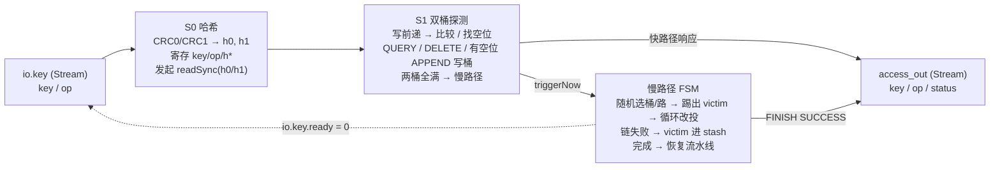
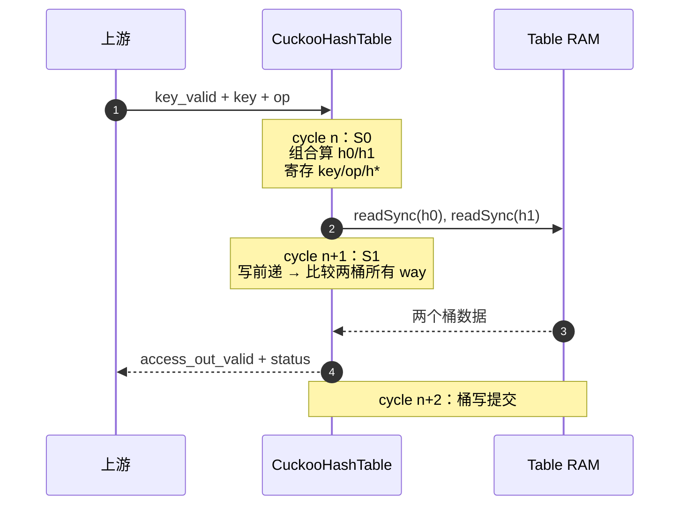

# 布谷鸟哈希表（Cuckoo Hash Table）设计思路

> 参考实现：[MultiHashTable.scala](../../src/main/scala/hash/MultiHashTable.scala)、[HashTable.scala](../../src/main/scala/hash/HashTable.scala)、[CrcCore.scala](../../src/main/scala/hash/CrcCore.scala)
> v1 实现：[CuckooHashTable.scala](../../src/main/scala/hash/CuckooHashTable.scala)
> **v1 详细文档：[CuckooHashV1.md](CuckooHashV1.md)**（特性、接口、微架构、流程图、状态机、性能、测试）
> 测试：[test_cuckoo_hash_table.py](../../src/test/pyuvm/CuckooHashTable/test_cuckoo_hash_table.py)
> 生成脚本：[gen_cuckoo.sh](../../src/test/pyuvm/CuckooHashTable/gen_cuckoo.sh)
> 交互演示：[CuckooHashV1Demo.html](CuckooHashV1Demo.html)

## v1 落地摘要

- FPGA 目标，默认参数 `CuckooHashTable(64, 8, 4)`：256 桶 × 4 way，容量 1024，`maxKicks=8`，`stashDepth=4`。
- 快路径 2 拍延迟、1 次/拍；两桶全满的 APPEND 进入整表 stall 的逐出慢路径，失败项进 stash。
- 输入/输出均为 `Stream`，响应保序；慢路径和下游反压都会传到 `io.key.ready`。
- `stat` 输出提供 APPEND 满路径/慢路径比例、踢出次数分布、query/delete 命中、stash 命中、load 与高水位等指标。
- cocotb + Verilator 验证通过：定向、88% 负载、随机混合、back-to-back 突发（13078 ns，最终 937 key）。

实现细节见 [CuckooHashV1.md](CuckooHashV1.md)。

## 0. 设计定位

**布谷鸟表 ≈ MultiHashTable 的双哈希探测通路 + 一个逐出重定位状态机。**

- 查询、删除、以及"有空位"的插入，三条快路径与现有多哈希表几乎同构：2 拍延迟、1 次/拍吞吐。
- 只有"两个候选桶都满"的 APPEND 才进入多拍慢路径，做 cuckoo 逐出改投。
- 复用现有的 `HashEntry/HashAccess/HashOperation/MultiHashOutputStatus` 和写前递技巧，接口与 `MultiHashTable` 保持同构，便于 A/B 对比和替换。



## 1. 存储组织与参数

### 1.1 Entry 格式

```
+-------+-----+------------------+
| valid | src | key (keyWidth)   |
+-------+-----+------------------+
```

- `src`：1 bit，标记该 key 当初是通过 h0 还是 h1 放进桶里的。
  - 改投时只需计算**另一个** CRC，省一个哈希单元，也少一拍依赖；否则要对 victim 同时算两个 CRC 再判断"哪个是当前桶"。
- 一个桶作为一个宽字整体存储，地址 = hash 值，沿用 MultiHashTable 的 `Mem[Bits]` 组织：

```
bucket word = way0 | way1 | ... | way(W-1)
Mem depth   = 2^hashValueWidth
```

### 1.2 端口

- 探测需要 **2 读口**（h0/h1 并行）+ **1 写口**。
- 现有 MultiHashTable 已经对同一 `Mem` 发两次 `readSync`；FPGA 上 2R1W 通常综合成两块 BRAM（写口复制、写两遍），ASIC 可用 2R1W regfile/SRAM。
- **v1 实现**：沿用双 `readSync`（2R1W）。生成 Verilog 里是两个 `always @(posedge clk)` 读端口 + 一个写端口，FPGA 上预计映射为双 BRAM（或 LUTRAM）。若后续在意 BRAM，可改两拍分时读（延迟 3 拍）。

### 1.3 建议参数

| 参数 | 建议值 | 说明 |
|---|---|---|
| `keyWidth` | 64 | 与现有一致 |
| `hashValueWidth` | 8 | 桶数 256 |
| `bucketDepth` W | 4 | 容量 1024，负载阈值约 97% |
| `maxKicks` | 8 | 慢路径最坏约 20 拍 |
| `stashDepth` S | 4 | 每项 `{valid, key}` |

容量 = `2^hashValueWidth × W`；例：64b key、h=8、W=4 → 1024 项 ≈ 66 Kb 存储。

## 2. 哈希函数

- 复用 [CrcCore.scala:19](../../src/main/scala/hash/CrcCore.scala#L19) 的 `CRC`，两组不同多项式：
  - h0：poly `0x9B`，init `0xFF`
  - h1：poly `0x1D`，init `0xFF`
- CRC 是纯组合逻辑，S0 一拍算出两个索引，与现有多哈希表一致。
- 可预留 CRC seed 寄存器，便于软件在重哈希/重建时换种子。

## 3. 快路径流水线

### 3.1 周期行为



### 3.2 S1 决策

| op | 条件 | 动作 / 状态 |
|---|---|---|
| QUERY | 命中两桶或 stash | `SUCCESS` |
| QUERY | 未命中 | `NON_EXIST` |
| DELETE | 命中 | 生成清 valid 的桶写，`SUCCESS` |
| DELETE | 未命中 | `NON_EXIST` |
| APPEND | 已在两桶/stash | `EXIST`，不写 |
| APPEND | h0 桶有空位 | 写入 h0（`src=0`），`SUCCESS` |
| APPEND | h0 满、h1 有空位 | 写入 h1（`src=1`），`SUCCESS` |
| APPEND | 两桶全满 | 进入慢路径 |
| 任意 | h0 == h1 | 只读一次；最多写一次；APPEND 时不重复判空 |

写前递直接沿用 [MultiHashTable.scala:140](../../src/main/scala/hash/MultiHashTable.scala#L140) 的 `rdout_proc`：`wrEnD1 && wrAddrD1 == h*_d1` 时用上一拍写数据替代 RAM 输出，解决 back-to-back 同桶 RAW。

**快路径延迟 2 拍，查询吞吐 1 次/拍。** 响应由 S1 组合直接驱动 `access_out.valid`（n+1 即有效），没有额外的输出寄存器；下游 `ready` 为低时 S1 保持，写口会重复发出同一笔写入（同址同数据，幂等）。

## 4. 慢路径：逐出重定位

### 4.1 触发

S1 发现 APPEND 两桶全满时：

1. 先查 stash 是否有空位（见第 5 节）。没有 → 本拍直接返回 `UNAVAILABLE`，**不产生任何写**。
2. 有空位 → 拉低 `io.key.ready`，进入 FSM，用 S1 已读出的桶内容直接选 victim（省一次读）。

### 4.2 算法

```text
// 入口：S1 的两个桶内容已知
b   = randomBit ? h0 : h1            // 选一个桶（若 h0==h1 则固定）
w   = randomWay(W)                    // LFSR 随机选路
victim = bucket[b][w]
写 bucket[b][w] = 新 key（src = 0/1 对应所选哈希）
pending = victim; cur = b

for kick in 0 until maxKicks:
    alt = other_hash(pending)         // 由 pending.src 决定算哪个 CRC
    if alt == cur:                    // 两个哈希撞同一桶，该 key 无法改投
        stash(pending); done
    read bucket[alt]                  // 读地址与上一拍写同桶时必须 forwarding
    if 存在空位:
        写 bucket[alt][空位] = pending（src 翻转）
        done
    w' = randomWay(W)
    new = bucket[alt][w']
    写 bucket[alt][w'] = pending（src 翻转）
    pending = new; cur = alt
超限:
    stash(pending); done
```

### 4.3 周期节奏（实际 FSM：IDLE / EVAL / READ / FINISH）

```
S1 触发拍：用已读出的桶选 victim，写新 key 到 (b,w)，同时算 other_hash(victim) 并发第一次读
+1 (EVAL)：alt 桶数据有效；有空位→写 victim、转 FINISH；否则选路、写 pending、算下一轮 hash、转 READ
+2 (READ)：用寄存的 fsmAlt 发读
+3 (EVAL)：下一轮 alt 桶数据有效，重复
...
FINISH  ：按需 stash，输出 SUCCESS；等下游 ready 后回 IDLE
```

- 第一脚只花 1 拍（复用 S1 读出的桶内容）。
- 后续每脚 2 拍（READ + EVAL），写和 hash 都在 EVAL 内完成。
- `maxKicks=8` 时慢路径约 17~20 拍，加前面 2 拍流水，最坏约 20~25 拍。

### 4.4 必须注意的坑

1. **快路径写后读 forwarding**：back-to-back 同桶访问必须旁路上一拍写，FPGA BRAM 同址读写返回旧值（WRITE_FIRST/READ_FIRST），不能依赖 RAM 语义。慢路径因为会检查 `nextAlt != fsmAlt`，读地址和上一拍写地址天然不同，理论上不需要转发；实现里仍对慢路径读数据套了同一个转发 mux（无害）。
2. `src` 写入新桶时翻转。
3. **随机选桶/选路是必要属性**，固定踢 way0 会出现病态长链和环。LFSR 即可，仿真时用固定种子保证可复现。
4. victim 是旧 key，不能丢；最终失败必须进 stash（第 5 节）。
5. 若 `h0 == h1`，该 key 只有一个候选桶；踢出的 victim 若也撞同一桶，直接进 stash。

## 5. 失败处理：stash 预检（推荐）

### 5.1 为什么不直接丢 / 为什么不做 undo log

- 逐出链最后一个 pending 是**旧 key**，直接丢会造成表内数据丢失。
- undo log 回滚可行：每脚记录 `(bucket, way, 旧 entry)`，超限后逆序写回，返回 `UNAVAILABLE`，表状态与操作前完全一致。代价约 `maxKicks × (h + log2W + keyWidth + 2)` 个触发器 + 一段回滚写序列。

### 5.2 stash 方案

小全相联溢出区，深度 S=2~4，每项 `{valid, key}`：

- **预检**：进入慢路径前查 stash 有无空位。
  - 无空位 → 立即 `UNAVAILABLE`，一拍写都不发，天然原子。
  - 有空位 → 预留该位置，开始逐出。
- **链失败**（超 kick 上限或 `alt == cur`）→ 把 pending 写进预留的 stash 位，返回 `SUCCESS`。
- 因为有预检保证，stash 写一定成功，**不需要 undo log**。
- 查询/删除/插入的 exist 判断并行加一路 stash 比较（S 个 key 比较器），延迟不变。
- 可选：空闲周期后台 drain，把 stash 项重新尝试插回桶里，避免长期占用。
- **v1 实现**：`stashDepth=4`，4 个并行 key 比较器；暂不做后台 drain，stash 项只能通过 DELETE 清除。

### 5.3 对比

| 方案 | 资源 | 失败时原子性 | 查找路径改动 | 推荐 |
|---|---|---|---|---|
| undo log 回滚 | maxKicks 条日志 × entry | 完全原子 | 无 | 备选 |
| stash 预检 | S 项 × key + S 个比较器 | 失败时零写；成功时 key 必可查 | 加一路并行比较 | **推荐** |

W=4、目标负载 ≤90% 时进 stash 的概率已极低，S=4 基本等于"永不失败"。

## 6. 并发、反压与冒险

现有接口是 `Flow`，无法 stall；慢路径必须能反压，所以新模块输入输出建议改用 `Stream`：

### 6.1 v1（已实现）

- 检测到慢路径立即拉低 `io.key.ready`，FSM 跑完再放开；流水线各寄存器保持。
- 输出直接由 S1/FINISH 组合驱动 `access_out.valid`，**没有 skid buffer**：下游 `ready` 为低时 S1 或 FINISH 原地保持，反压会一路传到上游。
- 响应天然保序，延迟可变（快路径 2 拍，慢路径最坏 ~25 拍），下游按 valid/ready 处理。
- FSM 与流水线共用一个写口，用 mux 仲裁；慢路径期间 S1 为空，二者不会同时写。
- S1 因下游反压保持时，会重复发出同一笔桶写（同址同数据），是幂等的。

### 6.2 v2（可选优化，二期）

慢路径期间允许 QUERY 继续：

- 读路径加 pending-write forwarding（同时只有一个在飞的改投写，一个 buffer 够）。
- 加一路 in-flight key 比较：被踢的 key 在 FSM 寄存器里、不在 RAM 中，查询命中它也要返回 `SUCCESS`。
- DELETE/APPEND 仍然 stall（会改变 FSM 前提）。
- 能显著降低对上游的抖动，但验证复杂度上一个台阶。

## 7. 负载因子、监控与重哈希

- 理论负载阈值（2 hash）：W=1 ≈ 50%，W=2 ≈ 89%，W=4 ≈ 97%，W=8 ≈ 99%。工程目标建议 **80%~90%**：再高，踢链长度、stash 占用和慢路径概率都上升很快。
- 建议加 debug/stat 输出：`kick_fail_cnt`、`max_chain_len`、`stash_used`，软件据此判断负载和是否重建。
- **不做在线自动扩容**（要停表 + 全量搬移）。失败/高负载上报软件，换 CRC seed 或扩容后重建。
- 真需要在线扩容，后续可做"双表 + 后台搬移"。

## 8. 变体与裁剪

| 变体 | 说明 | 适用 |
|---|---|---|
| **Cuckoo Filter** | entry 只存 8-bit fingerprint；`alt = cur ^ hash(fp)`；改投不需要 key，也不需要重算 CRC | 只判存在/去重，存储降一个数量级 |
| **d=3 cuckoo** | 3 个候选桶，负载可到 99%+；多一个读口/CRC，改投要选"非当前桶的候选" | 需要极高负载 |
| **不踢的简化版** | 满则进 overflow CAM（只有 stash），FSM 全省 | 插入少、负载低，优先面积 |

## 9. 接口与参数（v1 实现）

实现文件：[CuckooHashTable.scala](../../src/main/scala/hash/CuckooHashTable.scala)

```scala
case class CuckooHashTable(
  keyWidth: Int,
  hashValueWidth: Int,
  bucketDepth: Int,
  maxKicks: Int = 8,
  stashDepth: Int = 4
) extends Component {
  val io = new Bundle {
    val key:        Stream[HashAccess]   = slave Stream (HashAccess(keyWidth))
    val access_out: Stream[MultiHashOut] = master Stream (MultiHashOut(keyWidth))
  }
}
```

- 默认例化：`CuckooHashTable(64, 8, 4)` → 256 桶 × 4 way，容量 1024；`maxKicks=8`、`stashDepth=4`。
- entry 宽 `keyWidth+2`（valid/src/key），桶宽 `(keyWidth+2) × bucketDepth` = 264 bit。
- 状态复用 `MultiHashOutputStatus`：`SUCCESS / EXIST / NON_EXIST / UNAVAILABLE`。
- 关键内部信号：`entries0/1`、`freeOH0/1`、`firstWrEntries`、`evalWrEntries`、`state`（IDLE/EVAL/READ/FINISH）、`pendingKey/pendingSrc`、`fsmAlt`、`kickCnt`、`stashValid/stashKey`、`wrEnD1/wrAddrD1/wrDataD1`。
- 写口 `wrEn/wrAddr/wrData` 由快路径和 FSM mux；v1 没有 stat/debug 输出，需要时再加 `kick_fail_cnt` / `stash_used`。
- 与 `MultiHashTable` 同构的 Stream 接口便于做同参数 A/B 对比（容量、延迟、资源、负载上限）。

## 10. 实现与验证摘要

v1 已按本方案实现并通过 cocotb + Verilator 功能验证：

- 快路径（QUERY / DELETE / 有空位 APPEND）：2 拍延迟，1 次/拍。
- 慢路径（两桶全满）：整表 stall，逐出链 `maxKicks=8`，失败项进 4 项 stash。
- 测试覆盖：定向读写/删除、stash 定向（强制 `stashHit`）、88% 负载填表、1500 次随机混合、400 次 back-to-back 突发；`TESTS=2 PASS=2`（总 12930 ns）。
- 表初始化：仿真里 TB 清 RAM；FPGA 上依赖 BRAM 上电为 0，量产前建议软件 clear。

详细实现、流程图、状态机、时序和测试记录见 [CuckooHashV1.md](CuckooHashV1.md)。

