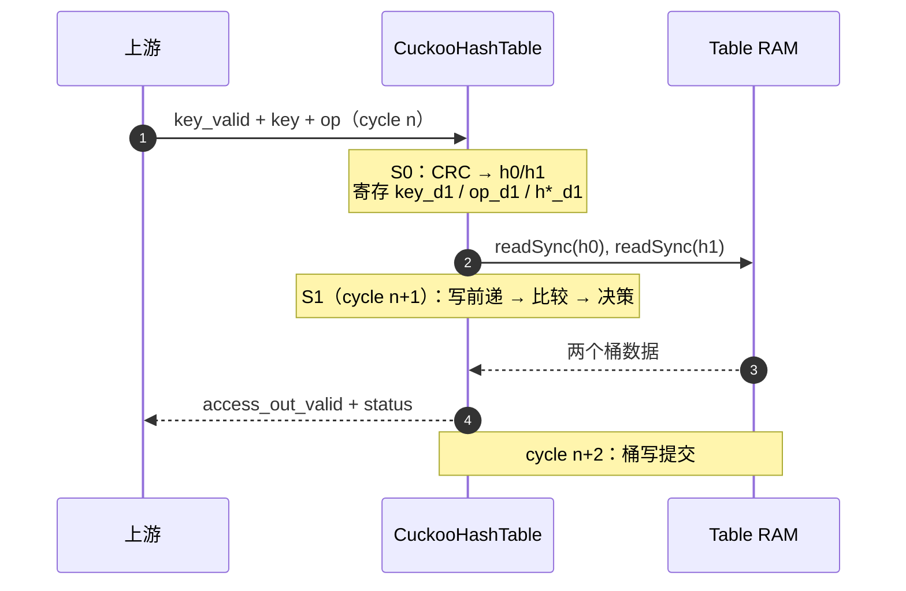
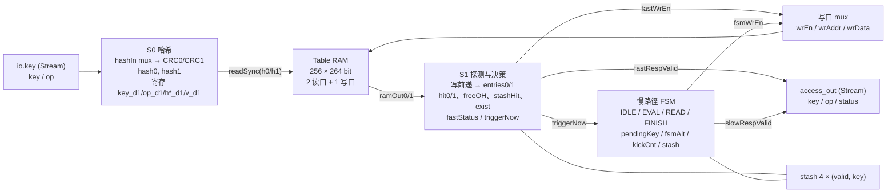
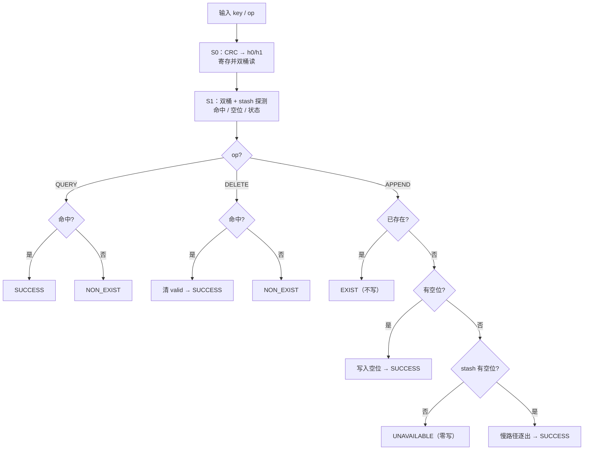
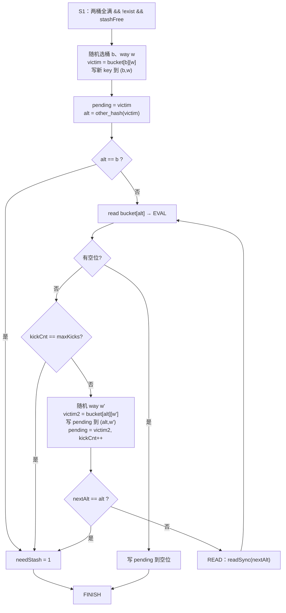
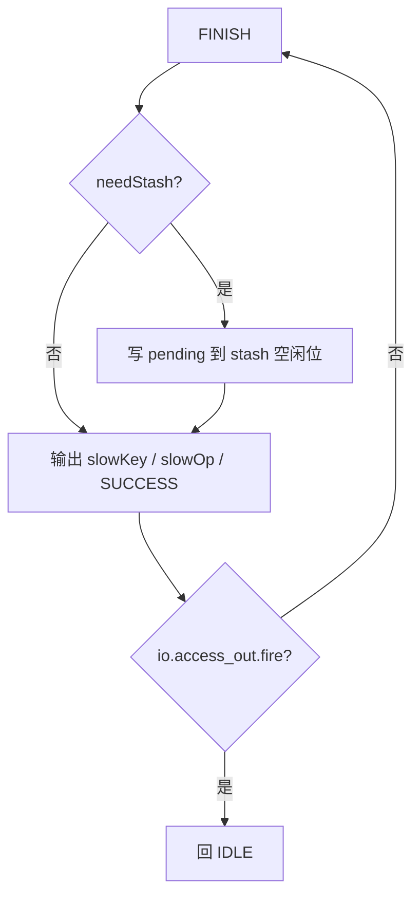
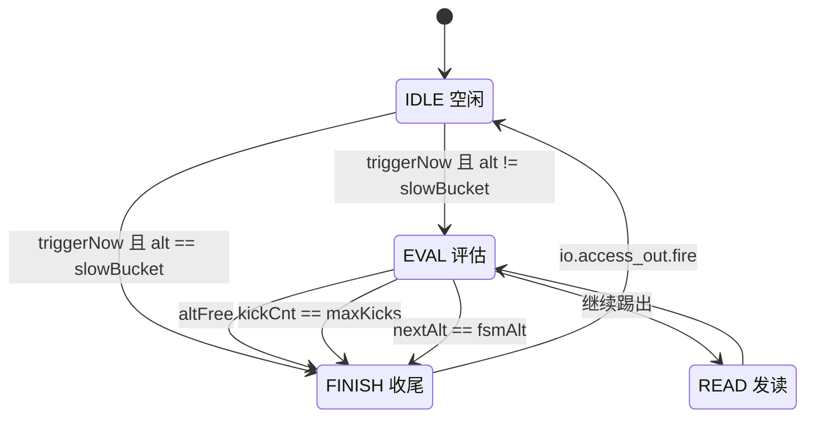

# 布谷鸟哈希表 v1 实现文档

> 方案文档：[CuckooHash.md](CuckooHash.md)
> RTL：[CuckooHashTable.scala](../../src/main/scala/hash/CuckooHashTable.scala)
> 测试：[src/test/pyuvm/CuckooHashTable](../../src/test/pyuvm/CuckooHashTable)
> 生成脚本：[gen_cuckoo.sh](../../src/test/pyuvm/CuckooHashTable/gen_cuckoo.sh)
> 生成 RTL：[verilogGen/CuckooHashTable.v](../../verilogGen/CuckooHashTable.v)
> 交互演示：[CuckooHashV1Demo.html](CuckooHashV1Demo.html)

---

## 1. 概述

v1 是一个面向 FPGA 的 2-way 布谷鸟哈希表，支持 APPEND / DELETE / QUERY 三种操作。
它沿用 [MultiHashTable.scala](../../src/main/scala/hash/MultiHashTable.scala) 的双哈希并行探测结构，
在此基础上增加了一个逐出-改投（eviction / relocation）状态机：

- **快路径**：查询、删除、以及两个候选桶中还有空位的插入，2 拍延迟、1 次/拍。
- **慢路径**：两个候选桶都满的插入，整表 stall，随机踢出一个 victim 并沿 cuckoo 链改投；
  链长超过 `maxKicks` 或 victim 无法改投时，把 pending key 写入 4 项 stash。
- **失败原子性**：进入慢路径前先检查 stash 空位；stash 满时直接返回 `UNAVAILABLE`，
  不产生任何写。因此失败时表内容不变，不需要 undo log。

当前状态：RTL 已完成，通过 Verilator + cocotb 功能验证（见第 8 节）。

---

## 2. 特性

| 编号 | 特性 | 说明 |
|---|---|---|
| F1 | 2-way cuckoo | 每个 key 有两个 CRC 候选桶，桶深 4 |
| F2 | 快路径 1 op/cycle | QUERY / DELETE / 有空位 APPEND，2 拍延迟 |
| F3 | 慢路径逐出 | 两桶全满时随机踢出 victim，沿链改投 |
| F4 | stash 预检 | stash 满时零写失败；慢路径失败项写入 stash |
| F5 | `Stream` 反压 | 输入输出均为 valid/ready；慢路径和下游反压都会 stall 上游 |
| F6 | 完整状态语义 | `SUCCESS / EXIST / NON_EXIST / UNAVAILABLE` |
| F7 | `src` 标签 | 每个 entry 1 bit，标记通过 h0 还是 h1 放入，改投只需算另一个 CRC |
| F8 | LFSR 随机 | 16-bit LFSR 选桶和 way，避免固定路号的病态长链 |
| F9 | 写前递 | back-to-back 同桶写读直接旁路，不依赖 BRAM 同址读写语义 |
| F10 | 参数化 | `keyWidth / hashValueWidth / bucketDepth / maxKicks / stashDepth` |
| F11 | 响应保序 | 单条流水线 + 慢路径整表 stall，响应严格按输入顺序输出 |
| F12 | FPGA 友好 | 纯 RTL，无厂商原语；存储为 2R1W `Mem` |
| F13 | 可复现验证 | cocotb scoreboard + Verilator，支持 FST 波形 |

---

## 3. 接口

### 3.1 顶层端口

| 信号 | 方向 | 位宽 | 说明 |
|---|---|---|---|
| `clk` | in | 1 | 时钟 |
| `reset` | in | 1 | 同步复位，高有效 |
| `key_valid` | in | 1 | 输入操作有效 |
| `key_ready` | out | 1 | 输入可接收；慢路径/反压时为低 |
| `key_payload_key` | in | `keyWidth` | 操作 key，默认 64 bit |
| `key_payload_op` | in | 2 | APPEND / DELETE / QUERY |
| `access_out_valid` | out | 1 | 响应有效 |
| `access_out_ready` | in | 1 | 下游可接收 |
| `access_out_payload_key` | out | `keyWidth` | 响应 key（与请求一致） |
| `access_out_payload_op` | out | 2 | 响应 op（与请求一致） |
| `access_out_payload_status` | out | 2 | 操作结果 |

`noIoPrefix()`，端口名与生成 Verilog 一致。

### 3.2 枚举编码

| 枚举 | 名称 | 编码 |
|---|---|---|
| `HashOperation` | APPEND | 0 |
| | DELETE | 1 |
| | QUERY | 2 |
| `MultiHashOutputStatus` | SUCCESS | 0 |
| | NON_EXIST | 1 |
| | UNAVAILABLE | 2 |
| | EXIST | 3 |
| `CuckooHashState` | IDLE | 0 |
| | EVAL | 1 |
| | READ | 2 |
| | FINISH | 3 |

### 3.3 操作语义

| 操作 | 条件 | 状态 | 表动作 |
|---|---|---|---|
| APPEND | key 已在桶或 stash 中 | `EXIST` | 不写 |
| APPEND | 未命中，h0/h1 有空位 | `SUCCESS` | 写入空位，`src` 对应 h0/h1 |
| APPEND | 未命中，两桶全满，stash 有空位 | `SUCCESS` | 进入逐出慢路径 |
| APPEND | 未命中，两桶全满，stash 满 | `UNAVAILABLE` | 不写 |
| DELETE | key 在桶或 stash 中 | `SUCCESS` | 清 valid（桶或 stash） |
| DELETE | 未命中 | `NON_EXIST` | 不写 |
| QUERY | key 在桶或 stash 中 | `SUCCESS` | 不写 |
| QUERY | 未命中 | `NON_EXIST` | 不写 |

说明：

- 慢路径成功时统一返回 `SUCCESS`，即使有 victim 被放入 stash。
- v1 不提供 “本次插入是否用了 stash” 的状态位/计数器；需要时可加 debug 输出。
- `UNAVAILABLE` 只在“两桶全满 + stash 满 + key 不存在”时出现，且此时没有任何写。

### 3.4 握手规则

- 输入：`key_valid && key_ready` 在时钟上升沿同时为 1 时，操作被接收。
- 输出：`access_out_valid && access_out_ready` 在上升沿同时为 1 时，响应被下游接收。
- 响应保序：第 i 个被接收的操作，其响应一定先于第 i+1 个操作的响应。
- 下游 `access_out_ready` 为低时，快路径 S1 或慢路径 FINISH 原地保持；
  反压会通过 `io.key.ready` 传回上游。
- 复位只复位控制寄存器，**不清表 RAM**；软件/测试平台需要自行初始化。

### 3.5 快路径时序

以一次 QUERY 为例（S0 在 cycle n，S1 在 cycle n+1）：

| 周期 | 动作 |
|---|---|
| n | 接收输入；CRC 组合算出 h0/h1；寄存 `key_d1/op_d1/h0_d1/h1_d1`；发起 `readSync(h0)` 和 `readSync(h1)` |
| n+1 | RAM 输出两个桶；写前递；比较/决策；`access_out.valid` 有效 |
| n+2 | n+1 发起的桶写落 RAM |

从输入接收到响应可见为 2 拍；下游 ready 持续为高时吞吐 1 次/拍。



---

## 4. 微架构

### 4.1 总体框图



### 4.2 存储组织

- `tableDepth = 1 << hashValueWidth`，默认 256。
- `entryWidth = keyWidth + 2`，默认 66。
- `bucketWidth = entryWidth × bucketDepth`，默认 264。
- 一个桶作为一个宽字：`way0 | way1 | way2 | way3`。
- 生成 Verilog 的 bit 布局（默认参数）：

```
way0: [ 65: 0]   way1: [131: 66]   way2: [197:132]   way3: [263:198]
entry 内部：bit0 = valid，bit1 = src，bit[65:2] = key
```

- 读口：两个同步读口，读地址在上升沿寄存，数据下一拍有效；读使能为低时输出保持。
- 写口：一个同步写口，写数据在上升沿提交。
- 同址读写：写提交与读地址寄存可能发生在同一沿，BRAM 返回旧值；
  由 `wrEnD1/wrAddrD1/wrDataD1` 的写前递解决。

### 4.3 哈希与 `src`

- 两个 CRC 单元：
  - h0：poly `0x9B`，init `0xFF`
  - h1：poly `0x1D`，init `0xFF`
- `hashIn` mux：
  - `triggerNow` 时 → 新踢出的 victim key
  - 状态 `EVAL` 时 → 当前 EVAL victim key
  - 其余时刻 → `io.key.key`
- `src` 含义：该 entry 当前放在 `h0`（src=0）还是 `h1`（src=1）对应的桶里。
  - 改投时 `alt = src ? h0 : h1`，新位置的 `src = !src`。
  - 这样每个 victim 只需一次 CRC 计算，不需要保留“当初用哪个哈希”的额外信息。
- `h0 == h1` 时该 key 只有一个候选桶；读口会读同一地址两次，写/删除只写一次。
  如果 victim 的两个哈希也撞同一桶，则无法改投，直接进 stash。

### 4.4 快路径数据通路

**S0（cycle n）**

1. `hash0/hash1` 组合计算。
2. 寄存 `key_d1/op_d1/h0_d1/h1_d1/v_d1`。
3. 对两个读口发 `readSync(h0)`、`readSync(h1)`，使能为输入 fire。

**S1（cycle n+1）**

1. RAM 输出两个桶，先做写前递：

```
bucket0Word = (wrEnD1 && wrAddrD1 == h0_d1) ? wrDataD1 : ramOut0
bucket1Word = (wrEnD1 && wrAddrD1 == h1_d1) ? wrDataD1 : ramOut1
```

2. 把桶字拆成 `entries0/1`（4 个 `CuckooHashEntry`）。
3. 命中与空位：

```
hit0/hit1   = OR(entry.valid && entry.key == key_d1)
stashHit    = OR(stashValid[i] && stashKey[i] == key_d1)
exist       = hit0 || hit1 || stashHit
freeOH      = lower-zero-one-hot(valid bitmap)   // 最低空闲 way
free        = freeOH.orR
```

`freeOH` 的算法：对 valid 位图做 `((bitmap + 1) ^ bitmap) & (bitmap + 1)`，
得到最低 0 位（最低空闲 way）的 one-hot；全满时为 0。**必须用 valid 位图**，不能用空闲位图。

4. 写目标选择：

```
APPEND : wrTo0 = free0；wrTo1 = !free0 && free1
DELETE : wrTo0 = hit0；wrTo1 = !hit0 && hit1
```

5. 写数据：复制读出的桶内容，在目标 way 上：

- APPEND：`valid=1, key=key_d1, src = (目标桶 == h0 ? 0 : 1)`；
- DELETE：清掉匹配 key 的 entry 的 `valid`。

6. `fastStatus` 按第 3.3 节生成；`fastWrEn = v_d1 && (doAppendWr || doDeleteWr)`。

### 4.5 慢路径逐出

**触发条件**

```
triggerNow = state == IDLE
          && v_d1
          && op_d1 == APPEND
          && !exist
          && !free0 && !free1      // 两个候选桶都满
          && stashFree             // 预检：stash 必须至少有一个空位
```

`triggerNow` 时：

- 本拍不输出快路径响应；
- 拉低 `io.key.ready`；
- 用 S1 已读出的桶内容直接选 victim（省一次读）。

**第一脚**

1. 选桶：`b = (h0_d1 == h1_d1) ? h0 : (lfsr(0) ? h1 : h0)`。
2. 选 way：`w = lfsr[wayBits:1]`。
3. `victim = bucket[b][w]`。
4. 把新 key 写入 `(b, w)`，`src = (b == h0 ? 0 : 1)`。
5. `pending = victim`，`pendingSrc = victim.src`。
6. 计算 `alt = pendingSrc ? h0(victim) : h1(victim)`；如果 `alt == b`，victim 无法改投，转 FINISH 并入 stash；
   否则发起 `readSync(alt)`，进入 EVAL。

**EVAL**

- 读回 `alt` 桶，优先找空位：
  - 有空位 → 把 pending 写入空位（`src = !pendingSrc`），转 FINISH；
  - 没有空位：
    - `kickCnt == maxKicks` → 把 pending 放入 stash，转 FINISH；
    - 否则随机选 way `w'`，把 pending 写入 `(alt, w')`，`pending = victim2 = bucket[alt][w']`，
      `pendingSrc = victim2.src`，`kickCnt++`；
      - 如果 `alt2 == alt`，victim2 无法改投，转 FINISH 并入 stash；
      - 否则 `fsmAlt = alt2`，转 READ。
- `EVAL` 内同时完成写和下一跳 CRC/hash 计算。

**READ**

- 用寄存的 `fsmAlt` 发 `readSync`，下一拍回 EVAL。

**FINISH**

- 若 `needStash`，把 pending key 写入 stash 的最低空闲位；
- 输出慢路径响应：
  - `key = slowKey`，`op = slowOp`，`status = SUCCESS`；
- 等 `io.access_out.fire` 后回 IDLE。

### 4.6 stash

- 结构：`stashDepth=4`，每项 `{valid, key}`。
- 空闲位图：`stashValid` 4 bit，`stashFreeOH` 用“valid 位图最低 0 位”算法；全满时为 0。
- 查询/删除/插入的 `exist` 判断并行比较 4 个 stash key。
- DELETE 命中时清掉对应 stash valid。
- APPEND 慢路径失败时，把 pending 写入 `stashFreeOH` 指向的空位。
- **预检保证**：触发慢路径前 `stashFree=1`，FSM 期间 stash 不会被其他人修改，
  所以 FINISH 的 stash 写一定成功，不需要 undo log。
- v1 不做后台 drain：stash 项只能通过 DELETE 清除，或等软件重建表。

### 4.7 LFSR

- 16-bit LFSR，多项式 `x^16 + x^14 + x^13 + x^11 + 1`，init `0xACE1`。
- 每个时钟都更新（不在复位时清零）。
- bit 分配：
  - `lfsr[0]`：选桶；
  - `lfsr[wayBits:1]`：选 way（默认 `lfsr[2:1]`）。
- 触发拍和 EVAL 拍使用当前 LFSR 值；因为每拍更新，两脚之间随机值不同。

### 4.8 写口仲裁与写前递

所有写共用一个写口：

```
wrEn   = fastWrEn || fsmWrEn
wrAddr = fsmWrEn ? fsmWrAddr : fastWrAddr
wrData = fsmWrEn ? fsmWrData : fastWrData
```

- `fastWrEn` 和 `fsmWrEn` 互斥：
  - 慢路径期间 S1 为空，`v_d1=0`，`fastWrEn=0`；
  - 触发拍是 APPEND 且两桶全满，`doAppendWr=0`，也不会产生快写。
- 写前递寄存器：

```
wrEnD1   = RegNext(wrEn)
wrAddrD1 = RegNext(wrAddr)
wrDataD1 = RegNext(wrData)
```

- S1 的桶内容在比较/写数据生成前先与 `wrEnD1/wrAddrD1` 比较，解决 back-to-back 同桶 RAW。
- 下游反压导致 S1 保持时，同一笔写会重复发出；同址同数据，幂等。

### 4.9 流控与响应

```
fastRespValid = v_d1 && !triggerNow
slowRespValid = state == FINISH

s1Advance = v_d1 && (triggerNow || io.access_out.ready)
s0CanLoad = !v_d1 || s1Advance

io.key.ready = (state == IDLE) && s0CanLoad && !triggerNow
```

- 输出：

```
io.access_out.valid  = fastRespValid || slowRespValid
io.access_out.payload = 慢路径 ? {slowKey, slowOp, SUCCESS}
                               : {key_d1, op_d1, fastStatus}
```

- 没有 skid buffer：S1/FINISH 直接驱动响应；下游不接收时原地保持。
- 响应保序：慢路径期间整表 stall，后续操作不会越过慢路径响应。

---

## 5. 功能流程图

### 5.1 单次操作总流程



### 5.2 APPEND 慢路径流程



### 5.3 FINISH 流程



---

## 6. 状态机

### 6.1 状态编码

| 状态 | 编码 | 说明 |
|---|---|---|
| IDLE | 0 | 正常流水线；S1 可产生快路径响应或触发慢路径 |
| EVAL | 1 | 检查刚读回的 alt 桶，决定填空位/踢出/失败 |
| READ | 2 | 用 `fsmAlt` 发起下一跳读 |
| FINISH | 3 | 按需写 stash，输出慢路径响应，等下游接收 |

### 6.2 状态转移图



### 6.3 状态转移表

| 当前状态 | 条件 | 下一状态 | 本拍动作 |
|---|---|---|---|
| IDLE | `triggerNow && firstAlt != slowBucket` | EVAL | 写新 key 到 victim 位置；寄存 pending/slowKey/slowOp；`fsmAlt = firstAlt`；发起读 |
| IDLE | `triggerNow && firstAlt == slowBucket` | FINISH | 写新 key；`pending = victim`；`needStash = 1` |
| EVAL | `altFree` | FINISH | 把 pending 写入 alt 的空位；`needStash = 0` |
| EVAL | `!altFree && kickCnt == maxKicks` | FINISH | 不写；`needStash = 1` |
| EVAL | `!altFree && kickCnt < maxKicks && nextAlt == fsmAlt` | FINISH | 把 pending 写入 alt 的随机 way；`pending = victim2`；`needStash = 1` |
| EVAL | `!altFree && kickCnt < maxKicks && nextAlt != fsmAlt` | READ | 把 pending 写入 alt 的随机 way；`pending = victim2`；`kickCnt++`；`fsmAlt = nextAlt` |
| READ | 无条件 | EVAL | 用 `fsmAlt` 发起 `readSync` |
| FINISH | `io.access_out.fire` | IDLE | 按需把 pending 写入 stash；输出慢路径响应 |

### 6.4 慢路径寄存器

| 寄存器 | 位宽 | 作用 |
|---|---|---|
| `state` | 2 | FSM 状态 |
| `pendingKey` | `keyWidth` | 当前正在改投的 key |
| `pendingSrc` | 1 | pending 当前所在位置对应的哈希标签 |
| `fsmAlt` | `hashValueWidth` | 下一跳要读的桶地址 |
| `kickCnt` | `log2Up(maxKicks+1)` | 已踢出次数，触发拍置 1 |
| `slowKey` | `keyWidth` | 触发慢路径的原始请求 key |
| `slowOp` | 2 | 原始请求 op（APPEND） |
| `needStash` | 1 | FINISH 时是否需要把 pending 写入 stash |
| `stashValid` | `stashDepth` | stash 有效位 |
| `stashKey[i]` | `keyWidth` | stash key |

### 6.5 `kickCnt` 语义

- 触发拍（S1）完成第一次踢出，`kickCnt = 1`。
- 每次 EVAL 决定继续踢出时 `kickCnt++`。
- EVAL 看到 `kickCnt == maxKicks` 时不再踢出，直接把当前 pending 放入 stash。
- 默认 `maxKicks = 8`。

### 6.6 慢路径最坏周期

- 触发拍：1 拍；
- 第一次 EVAL：+1 拍；
- 之后每次踢出 2 拍（READ + EVAL）；
- 最多 8 次踢出，最坏约 1 + 2×(8−1) = 15 拍到“超限/放入 stash”；
- 加 FINISH 响应等待，整体最坏约 20~25 拍（含前面 2 拍流水）。

---

## 7. 时序与性能

### 7.1 延迟

| 场景 | 延迟（从输入接受到响应可见） |
|---|---|
| QUERY 快路径 | 2 拍 |
| DELETE 快路径 | 2 拍 |
| APPEND 有空位 | 2 拍 |
| APPEND 慢路径，一次改投成功 | 约 4~6 拍 |
| APPEND 慢路径，链长 8 | 约 20~25 拍 |
| APPEND 两桶满 + stash 满 | 2 拍（同拍返回 UNAVAILABLE） |

### 7.2 吞吐

- 快路径：下游持续 ready 时 1 次/拍。
- 慢路径：整表 stall，`io.key.ready` 为低；突发中遇到慢路径会插入气泡。
- 响应保序，慢路径不会导致后续响应乱序。

### 7.3 关键路径

| 路径 | 说明 |
|---|---|
| S0：`io.key.key → CRC → RAM 读地址` | 输入到读地址的组合 CRC 路径；与 MultiHashTable 相同 |
| S1：`RAM 输出 → 写前递 → 比较/空位 → 写数据` | 读数据到写数据的组合路径 |
| 慢路径首拍：`RAM 输出 → 选 victim → CRC → RAM 读地址` | 触发拍的组合路径，最长 |
| 慢路径 EVAL：`RAM 输出 → 空位/踢出选择 → CRC/hash → fsmAlt` | 下一跳 hash 组合路径 |

如果 FPGA 时序紧张，优先考虑给慢路径首拍加一拍寄存器（多 1 拍延迟），或把 S1 决策打拍。

### 7.4 资源估算（默认参数，未综合）

| 项 | 估算 |
|---|---|
| 桶存储 | 256 × 264 bit ≈ 66 Kib |
| 2R1W 映射 | 约 4 个 36Kb BRAM（双副本），具体看器件 |
| stash | 4 × 64 bit key + 4 valid + 4 个 64-bit 比较器 |
| FSM/控制寄存器 | 约 150~250 FF |
| CRC | 2 个 64 级 CRC-8 组合树，约数百 LUT |
| LFSR | 16 FF |

### 7.5 负载与容量

- 容量 `C = 2^hashValueWidth × bucketDepth = 256 × 4 = 1024`。
- 2 hash、W=4 的理论负载阈值约 97%；工程目标建议 ≤90%。
- 本次测试填到约 88% 后做随机/突发操作，最终模型 922 个 key（约 90%）。
- 超过目标负载后，慢路径触发率、踢链长度和 stash 占用会明显上升。

---

## 8. 测试

### 8.1 环境

- Verilator **5.036** + cocotb **2.0.1**（系统 Python 3.9）。
  - cocotb 2.0 要求 Verilator ≥ 5.036；本机用 Homebrew 历史 formula 安装 5.036
    （tap `local/verilator5036`），没有升级到最新的 5.054。
- 测试目录：[src/test/pyuvm/CuckooHashTable](../../src/test/pyuvm/CuckooHashTable)
- RTL 来源：`verilogGen/CuckooHashTable.v`（由 `src/test/pyuvm/CuckooHashTable/gen_cuckoo.sh` 生成）。
- 时钟周期 2 ns。
- pyuvm 已升级到 **4.0.1**（支持 cocotb 2.0，保留 `utility_classes` 等旧 API），
  `cocotb-bus` 已升级到 **0.3.0**；仓库里的 `DataCache` / `AvstWidthCov` 用例已验证通过。
- `cocotb-coverage` 已卸载（仓库测试没有使用它），`pip check` 无冲突。

### 8.2 Testbench 结构

- 时钟：`Clock(dut.clk, 2, "ns")`。
- 驱动：在 falling edge 同时设置 `valid/payload` 并采样 `ready`，
  在接受到的那一拍 rising edge 之后再撤 `valid`。
- 响应：在 falling edge 采样 `access_out_valid/payload`；`access_out_ready` 常 1。
- 模型：Python `set` 维护表内容；按响应顺序检查 key/op/status。
- RAM 初始化：reset 后通过 VPI 把 256 个桶清 0。

### 8.3 测试序列

| 阶段 | 内容 | 目的 |
|---|---|---|
| 定向 | 16 个 key 的 APPEND / QUERY / DELETE、重复 APPEND、删除不存在 key | 基本语义 |
| stash 定向 | 5 个 `h0==h1==0x2E` 的 key 填满同一桶，第 5 个触发慢路径，victim 进 stash；QUERY 验 `stashHit`，DELETE 验清空 | 确定性覆盖 stashHit |
| 填表 | 填到约 88%（含定向用例共 900 个 key） | 高负载下的慢路径 |
| 随机混合 | 1500 次 QUERY/APPEND/DELETE | 随机时序和状态组合 |
| back-to-back | 400 次 APPEND + 200 次 QUERY 连续突发 | 1/cycle 吞吐、写前递 |
| 末尾一致性 | 抽样 QUERY + 批量 DELETE | 最终一致性 |

stash 定向的 5 个 key 是用与 RTL 一致的 CRC-8 模型（poly `0x9B` / `0x1D`，init `0xFF`，
64 bit MSB-first）搜索出来的：前 4 个填满唯一候选桶 `0x2E`，第 5 个触发慢路径后，
victim 的另一个候选桶仍是 `0x2E`，无法改投，必然写入 stash。

### 8.4 Scoreboard 规则

- 响应 `key` 必须与请求 key 一致；响应 `op` 必须与请求 op 一致。
- APPEND：
  - key 已在模型中 → 必须 `EXIST`；
  - key 不在模型中 → 允许 `SUCCESS` 或 `UNAVAILABLE`；`SUCCESS` 才加入模型。
- DELETE：
  - key 在模型中 → 必须 `SUCCESS`，从模型删除；
  - 不在 → 必须 `NON_EXIST`。
- QUERY：
  - key 在模型中 → `SUCCESS`；否则 `NON_EXIST`。

### 8.5 结果

- **TESTS=2 PASS=2**，总仿真 12930 ns（2 ns 周期，约 6465 拍）：
  - `test_cuckoo`：12833 ns，最终模型 922 个 key；
  - `test_stash_hit`：97 ns，确认 `stashValid` 非 0、stash 中的 key 查询时
    `hit0=hit1=0 && stashHit=1`、DELETE 后 stash 清零。
- `dump.fst` 约 2.4 MB。
- Verilator lint：`--lint-only -Wall -Wno-fatal` 无 latch、多驱动、宽度错误；
  只有 enum `_string` 调试信号和少量未用 bit 的 UNUSEDSIGNAL 警告。

### 8.6 波形

```bash
export PATH="$HOME/Library/Python/3.9/bin:$PATH"
cd src/test/pyuvm/CuckooHashTable
make SIM=verilator          # 默认 WAVES=1，生成 dump.fst
make SIM=verilator WAVES=0  # 关闭波形，更快
```

`WAVES=1` 通过 cocotb 2.0 的 `VERILATOR_TRACE=1` + `--trace-fst` 打开 FST；
该开关是编译期的，切换后需要 `rm -rf sim_build`。

### 8.7 重新生成与运行

```bash
cd /Users/xiangtyy/IdeaProjects/spinalCode
bash src/test/pyuvm/CuckooHashTable/gen_cuckoo.sh   # 编译 + 生成 verilogGen/CuckooHashTable.v

export PATH="$HOME/Library/Python/3.9/bin:$PATH"
cd src/test/pyuvm/CuckooHashTable
make SIM=verilator
```

### 8.8 覆盖范围与未覆盖

已覆盖：

- 快路径 APPEND/QUERY/DELETE；
- 慢路径（含 `alt == cur` 的立即 stash 分支）；
- stash 写入/命中/删除（确定性定向用例，`stashHit` 已实际拉高）；
- 88%~90% 高负载；
- 随机混合操作；
- back-to-back 同桶写读（写前递）；
- 响应保序。

未覆盖/待补：

- 下游 `access_out_ready` 长时间为低的反压测试；
- 定向制造 cuckoo 链成环、强制 `maxKicks` 超限；
- 95% 以上负载扫描；
- 综合后网表的同址读写顺序/时序检查；
- 形式化不变量（成功插入必可查、无重复）证明；
- 上电/软件 clear 流程。

---

## 9. 已知问题、限制与注意事项

### 9.1 `freeOneHotOf` 位图用反（已修复）

最初的实现用空闲位图套 `(bitmap + 1) ^ bitmap & (bitmap + 1)`，
但该 trick 的语义是“在 bitmap 里找最低的 0 位”。对空闲位图使用会得到最低的**有效** way；
空桶（free 位图全 1）返回 0，导致 `free0 = false`，所有 APPEND 被误判为“两桶全满”而进入慢路径。
表现为插入返回 `SUCCESS` 但查询 miss。

正确写法是对 **valid 位图**做同样的运算，返回最低空闲 way 的 one-hot，全满时为 0。

### 9.2 RAM 初始化

- 复位不清表 RAM。
- 仿真中 Verilator 的 RAM 上电内容不保证为 0；测试平台在 reset 后用 VPI 清 256 个桶。
- FPGA 上 BRAM 上电通常为 0，但量产前建议软件显式 clear。

### 9.3 Testbench 握手

- 驱动必须在 falling edge 同时给 payload/valid 并采样 ready，
  否则可能少收/多收操作。
- back-to-back burst 不能在第一个 payload 之前提前拉高 valid，
  否则 DUT 会把上一笔残留 payload 当成新操作。

### 9.4 重复 key 不变量

- APPEND 在插入前会检查两个桶和 stash，正常操作不会产生重复 key。
- DELETE 只清第一个命中的桶（`hit0` 优先）。如果表内因异常出现重复 key，
  后续查询仍会命中另一份；这是防御性假设，不是 v1 的功能。

### 9.5 stash 不 drain

- v1 没有后台把 stash 项搬回桶的机制。
- stash 项只能通过 DELETE 清除；极端情况下 stash 可能长期占用。
- 需要时可加空闲周期 drain 或软件重建。

### 9.6 无在线 rehash

- 不支持动态扩容/换 seed。
- 高负载或 hash 分布不佳时，软件可换 CRC seed 或扩容后重建。

### 9.7 2R1W 存储映射

- v1 对同一个 `Mem` 发两次 `readSync` + 一次 `write`。
- 生成 Verilog 是两个读 always 块 + 一个写 always 块；
  FPGA 综合可能映射成双 BRAM 副本或 LUTRAM，需在实际工程确认资源和时序。

### 9.8 `h0 == h1`

- 该 key 只有一个候选桶；读写只操作一次。
- 踢出的 victim 如果两个哈希也撞同一桶，直接进 stash。

### 9.9 `UNAVAILABLE` 语义

- 只在“两桶全满 + stash 满 + key 不存在”时返回。
- 此时没有产生任何写，表内容与操作前完全一致。

### 9.10 响应延迟可变

- 快路径 2 拍，慢路径可能到 ~25 拍。
- 下游必须按 valid/ready 处理，不能假设固定延迟。
- 响应保序，但慢路径会 stall 后续操作。

---

## 10. 后续工作

1. **v2 并发查询**：慢路径期间允许 QUERY 继续；需要 pending-write forwarding +
   in-flight key 比较；DELETE/APPEND 仍然 stall。
2. **debug/stat 输出**：`kick_fail_cnt`、`max_chain_len`、`stash_used`、`kick_cnt`。
3. **stash drain**：空闲周期把 stash 项重新尝试插回桶。
4. **压力验证**：95% 负载扫描、强制成环/超限、下游反压、随机 seed。
5. **综合评估**：2R1W BRAM 映射、Fmax、资源；必要时给慢路径首拍加寄存器。
6. **变体**：d=3 cuckoo、Cuckoo Filter（只存指纹）、在线扩容。
7. **初始化/clear**：增加软件 clear 接口或初始化流程。
8. **形式化/断言**：无重复、成功插入必可查、失败零写。

---

## 附录 A：参数

| 参数 | 默认值 | 约束 | 说明 |
|---|---|---|---|
| `keyWidth` | 64 | ≥1 | key 位宽 |
| `hashValueWidth` | 8 | ≥1 | 桶地址位宽，桶数 = 2^h |
| `bucketDepth` | 4 | 2 的幂，≥2 | 每桶 way 数 |
| `maxKicks` | 8 | ≥1 | 最大踢出次数 |
| `stashDepth` | 4 | ≥1 | stash 项数 |

派生量：

| 名称 | 公式 | 默认值 |
|---|---|---|
| `entryWidth` | `keyWidth + 2` | 66 |
| `bucketWidth` | `entryWidth × bucketDepth` | 264 |
| `tableDepth` | `1 << hashValueWidth` | 256 |
| `wayBits` | `log2Up(bucketDepth)` | 2 |
| `kickBits` | `log2Up(maxKicks + 1)` | 4 |

## 附录 B：枚举编码

见 3.2 节。

## 附录 C：关键信号

| 信号 | 位宽 | 说明 |
|---|---|---|
| `v_d1` | 1 | S1 有效 |
| `key_d1` | `keyWidth` | S1 key |
| `op_d1` | 2 | S1 op |
| `h0_d1/h1_d1` | `hashValueWidth` | S1 的两个哈希地址 |
| `ramOut0/1` | `bucketWidth` | 两个读口输出 |
| `bucket0/1Word` | `bucketWidth` | 写前递后的桶字 |
| `entries0/1` | `bucketDepth × entryWidth` | 拆出的 entry |
| `hit0/1` | 1 | 桶命中 |
| `stashHit` | 1 | stash 命中 |
| `exist` | 1 | 桶或 stash 命中 |
| `freeOH0/1` | `bucketDepth` | 最低空闲 way one-hot |
| `free0/1` | 1 | 桶有空位 |
| `wrTo0/1` | 1 | 快路径写目标桶 |
| `fastWrEn` | 1 | 快路径写使能 |
| `wrEn/wrAddr/wrData` | 1/`hashValueWidth`/`bucketWidth` | 统一写口 |
| `wrEnD1/wrAddrD1/wrDataD1` | 同上 | 写前递寄存器 |
| `triggerNow` | 1 | 慢路径触发 |
| `slowBucket` | `hashValueWidth` | 触发拍选中的桶 |
| `firstVictimKey/Src` | `keyWidth`/1 | 触发拍 victim |
| `altValue` | `hashValueWidth` | victim 的另一个候选桶 |
| `pendingKey/pendingSrc` | `keyWidth`/1 | 正在改投的 key |
| `fsmAlt` | `hashValueWidth` | 下一跳读地址 |
| `kickCnt` | `kickBits` | 已踢出次数 |
| `slowKey/slowOp` | `keyWidth`/2 | 慢路径原始请求 |
| `needStash` | 1 | FINISH 是否需要写 stash |
| `stashValid` | `stashDepth` | stash 有效位 |
| `stashKey[i]` | `keyWidth` | stash key |
| `state` | 2 | FSM 状态 |
| `fastRespValid/slowRespValid` | 1/1 | 响应有效 |
| `s1Advance/s0CanLoad` | 1/1 | 流水线推进条件 |
