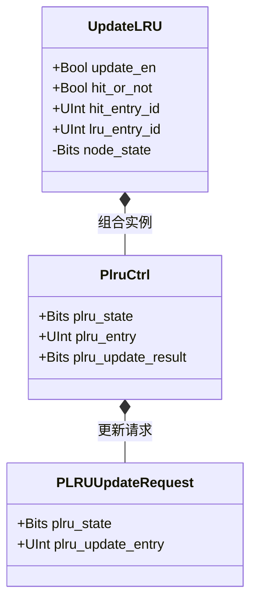
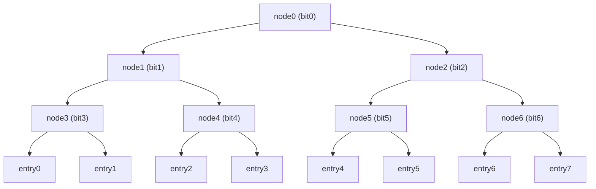
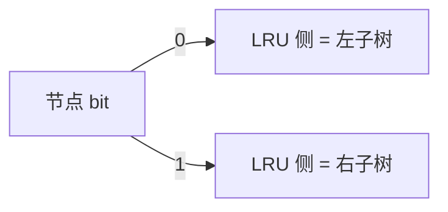
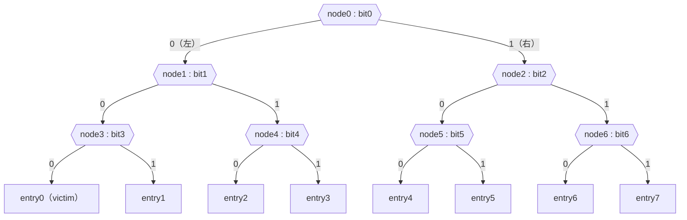
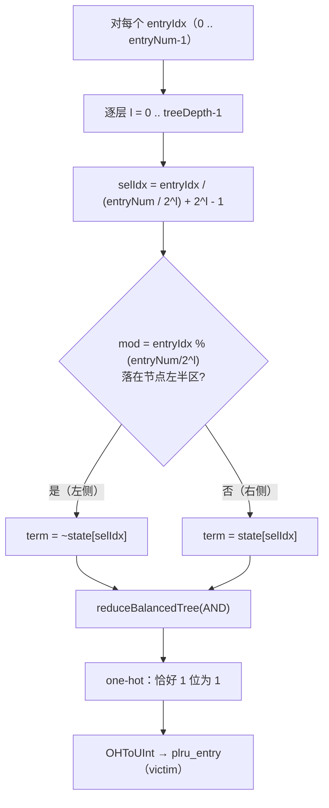
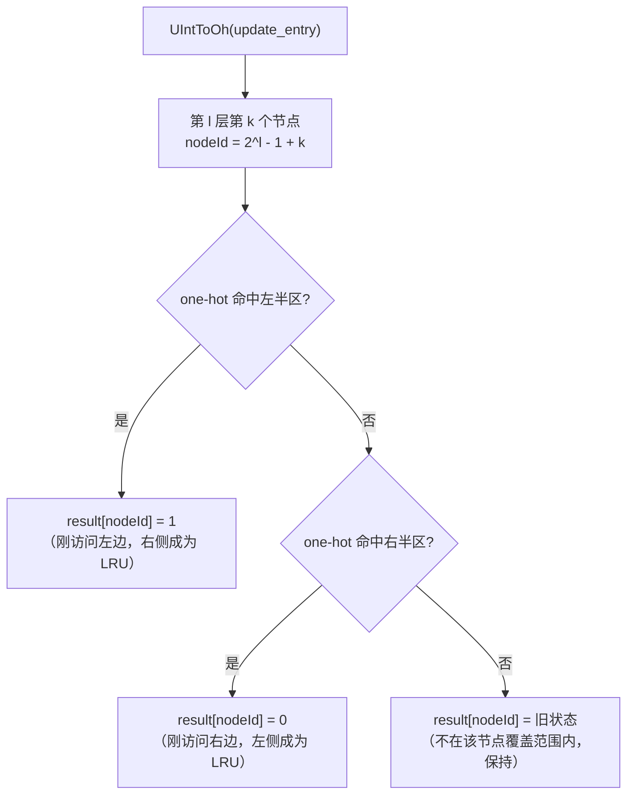
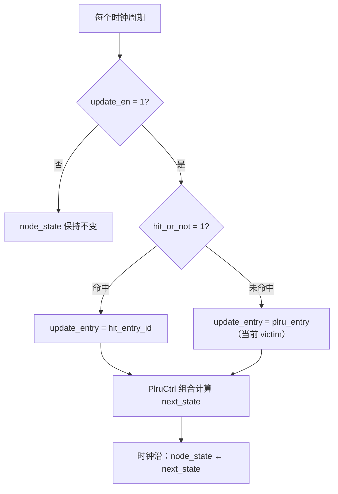
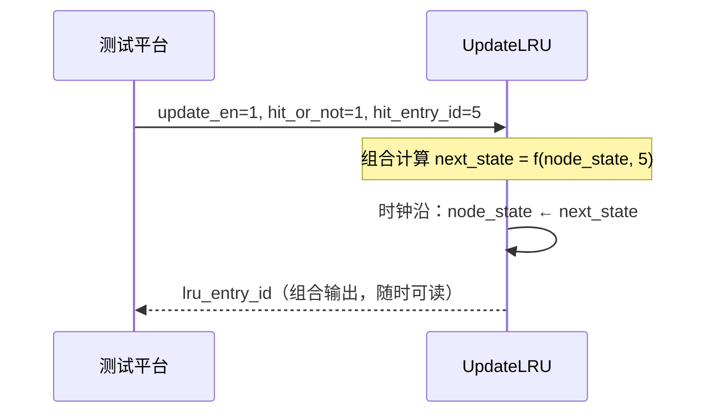
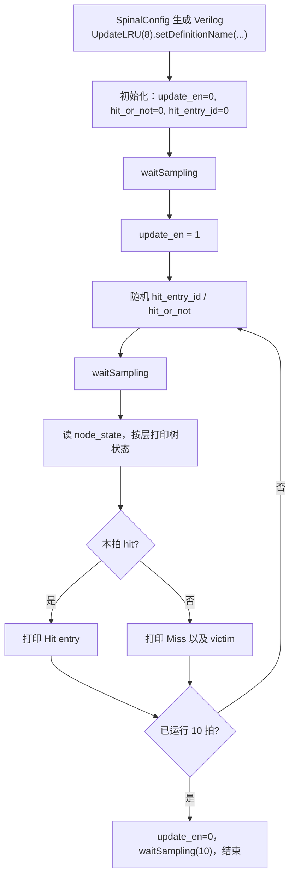

# PLRU 替换策略实现说明

> 源文件：`src/main/scala/plru.scala`
> 组件：`PLRUUpdateRequest` / `PlruCtrl` / `UpdateLRU` / `UpdateLRUSim`

## 目录

- [1. 概述](#1-概述)
- [2. 模块结构](#2-模块结构)
- [3. 状态编码：完全二叉树](#3-状态编码完全二叉树)
- [4. LRU entry 查找](#4-lru-entry-查找)
- [5. 状态更新](#5-状态更新)
- [6. UpdateLRU：时序封装](#6-updatelru时序封装)
- [7. 手算示例（4 项）](#7-手算示例4-项)
- [8. 仿真平台](#8-仿真平台)
- [9. 生成 Verilog](#9-生成-verilog)
- [10. 注意事项与改进建议](#10-注意事项与改进建议)
- [11. 代码索引](#11-代码索引)

---

## 1. 概述

本模块实现 **Tree-PLRU（树形伪 LRU）** 替换策略，用于组相联 cache 等多路结构中：

- 组合逻辑算出当前的**牺牲路（victim）**；
- 每次访问后，把被访问的 entry 标记为“最近使用（MRU）”，沿树路径更新状态。

相比真 LRU，PLRU 每个节点只需 1 bit：`N` 路（`N = 2^k`）只需 `N - 1` 位状态，命中率接近真 LRU，硬件开销小得多。

整个设计拆成“纯组合核（`PlruCtrl`）+ 状态寄存器外壳（`UpdateLRU`）”，便于复用和单独验证。

---

## 2. 模块结构



- `PlruCtrl`：纯组合。输入树状态与“要标记为 MRU 的 entry”，输出**当前 victim** 和**更新后的状态**。
- `UpdateLRU`：寄存器 `node_state` 保存树状态，按 hit/miss 决定更新入口。
- `UpdateLRUSim`：Verilog 生成 + 随机激励仿真。

---

## 3. 状态编码：完全二叉树

`plru_state` 共 `entryNum - 1` 位，按**层序编号**映射完全二叉树的内部节点：bit0 是根，bit1/bit2 是第二层，依此类推。`entryNum = 8` 时：



每个节点的 bit 表示“哪半边更久没被使用（LRU 侧）”：



> 该约定由更新逻辑反推得到，查找与更新两处自洽。

节点的 key 信息：

| 量 | 公式 | 说明 |
|---|---|---|
| 节点编号 | `nodeId = 2^l - 1 + k` | `l` 为层号（根为 0），`k` 为该层第几个节点 |
| 覆盖叶子数 | `leafNum = entryNum / 2^l` | 每层对 entry 空间对半分 |
| 左半区起点 | `leafNum * k` | 相对 entry 编号 |
| 右半区起点 | `leafNum * k + leafNum / 2` | 相对 entry 编号 |

---

## 4. LRU entry 查找

### 4.1 概念模型：沿 bit 逐层下降

如果串行地找 victim，就是从根开始，每层看 bit 指向哪边就往哪边走，走到叶子即为 victim：



### 4.2 实现方式：所有 entry 并行判断

代码没有用逐级 mux 链，而是对**每个 entry 并行**计算“它的整条路径是否都指向它”，再用平衡 AND 树归约：



要点：

- 每个节点只会指向一个孩子，所以**恰好一个 entry** 的全路径条件为真，结果是严格 one-hot；
- `reduceBalancedTree` 做平衡与树，避免长与链带来的组合延迟；
- 总代价约 `O(entryNum · log entryNum)` 个与门，换取更短、更均衡的关键路径。

---

## 5. 状态更新

把被访问的 entry 转成 one-hot（`UIntToOh`），然后对**每一层的每个节点**判断该 one-hot 落在节点的哪个半区：



结论：

- 更新规则就是“把路径上的节点 bit 指向**被访问侧的反面**”；
- 每层的节点全被遍历，因此每个状态位**恰好赋值一次**，纯组合、无 latch；
- 不在路径上的节点保持原值（取自 `plru_update_req.plru_state`）。

---

## 6. UpdateLRU：时序封装



语义说明：

| 场景 | 更新入口 | 含义 |
|---|---|---|
| 命中 | `hit_entry_id` | 命中的路刚被访问，标为 MRU |
| 未命中 | `plru_entry`（victim） | 即将填入新行的路，填入后就是 MRU |

时序关系（仿真中的一拍）：



其他细节：

- `node_state` 复位值为 0，等价于“所有节点都优先选左侧”，是一个合法且自洽的初态；随着访问逐步修正；
- `simPublic()` 让仿真能直接读 `node_state`；
- `lru_entry_id` 是组合输出，每拍都能给出当前 victim，供 cache 做替换决策。

---

## 7. 手算示例（4 项）

4 项时树状态为 3 位：`s0`（根）、`s1`（左节点，覆盖 entry0/1）、`s2`（右节点，覆盖 entry2/3）。

victim 判定式：

| entry | 条件 |
|---|---|
| entry0 | `s0 = 0` 且 `s1 = 0` |
| entry1 | `s0 = 0` 且 `s1 = 1` |
| entry2 | `s0 = 1` 且 `s2 = 0` |
| entry3 | `s0 = 1` 且 `s2 = 1` |

更新演示（初始全 0）：

| 时刻 | 访问 | 更新过程 | 新状态 `s0 s1 s2` | victim |
|---|---|---|---|---|
| 复位后 | — | — | `0 0 0` | entry0 |
| T1 | entry2 | 根：entry2 在右半区 → `s0` 清 0；右节点：entry2 在左半区 → `s2` 置 1；左节点不在路径上，保持 | `0 0 1` | entry0 |
| T2 | entry0 | 根：左半区 → `s0` 置 1；左节点：左半区 → `s1` 置 1；右节点保持 | `1 1 1` | entry3 |

注意 T1：访问右侧 entry 只把左侧整体标成 LRU，并不会改变左侧内部的相对顺序（`s1` 不变），所以 victim 仍是 entry0——这正是 PLRU “伪”的地方。

---

## 8. 仿真平台

`UpdateLRUSim` 先 `generateVerilog`，再用 `withWave` 编译仿真：



打印内容（`showLruState`）：把 `node_state` 按树层切片，每行对应一层（根 1 位、第二层 2 位、第三层 4 位），便于肉眼核对树状态。

---

## 9. 生成 Verilog

```scala
SpinalConfig(
  defaultConfigForClockDomains = ClockDomainConfig(resetKind = SYNC, resetActiveLevel = HIGH),
  defaultClockDomainFrequency  = FixedFrequency(100 MHz),
  nameWhenByFile               = false,
  anonymSignalPrefix           = "tmp"
).generateVerilog(UpdateLRU(8).setDefinitionName("plru_update_256"))
```

- 同步高电平复位，100 MHz 时钟；
- `nameWhenByFile = false`：`when` 块不按文件名命名，改用自动命名；
- `anonymSignalPrefix = "tmp"`：匿名信号加 `tmp` 前缀；
- `PlruCtrl` 内调用 `noIoPrefix()`，生成的端口名不带 `io_` 前缀。

---

## 10. 注意事项与改进建议

1. **`entryNum` 必须是 2 的幂**。`entryNum / 2^l`、`leafNum / 2`、`2^treeDepth - 1` 都隐含完全二叉树假设；`log2Up` 只决定位宽，非 2 的幂时查找和更新都会算错。
2. **命名误导**：`setDefinitionName("plru_update_256")` 对应的是 `UpdateLRU(8)`（8 项），名字里的 256 疑似复制遗留，建议改名。
3. **无用 import**：`import scala.tools.nsc.doc.base.comment.Bold` 未被使用，可删除。
4. **接口冗余**：`PLRUUpdateRequest.plru_state` 与 `PlruCtrl.io.plru_state` 在 `UpdateLRU` 中同源（都来自 `node_state`）。保留它是为了让更新逻辑自包含，但也可以合并为一个状态输入。
5. **`noIoPrefix` 不一致**：`PlruCtrl` 有 `noIoPrefix()`，`UpdateLRU` 没有，层级实例化时端口命名风格不同（顶层单独使用无影响）。
6. **复位值**：`node_state` 固定复位为 0。若需要不同初始策略，可参数化初值。
7. **可扩展**：非 2 的幂支持需要改变树结构（例如允许节点覆盖不等长区间），目前不支持。

---

## 11. 代码索引

| 内容 | 位置（`src/main/scala/plru.scala`） |
|---|---|
| `PLRUUpdateRequest`（更新请求 Bundle） | 8–11 |
| `PlruCtrl` 组件整体 | 13–58 |
| LRU entry 查找（one-hot + AND 树） | 23–37 |
| 状态更新（逐层逐节点） | 39–57 |
| `UpdateLRU` 时序封装 | 60–78 |
| `UpdateLRUSim` 仿真入口 | 83–136 |
| Verilog 生成配置 | 84–89 |
| 仿真激励与打印 | 91–135 |
