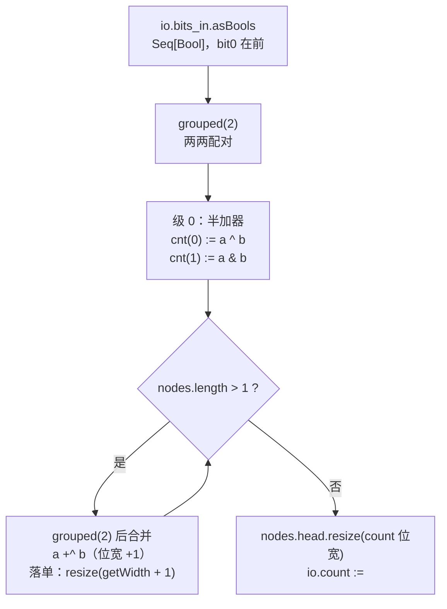
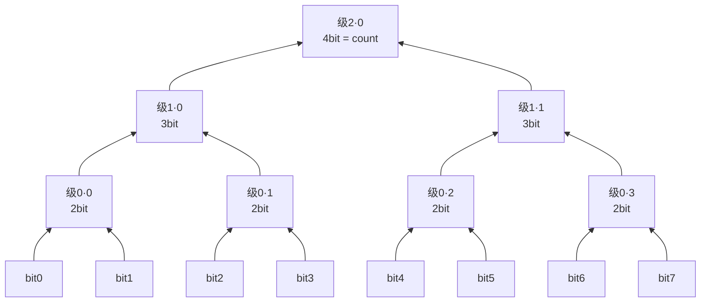

# PopCountTree 分治加法树 popcount 实现说明

> 源文件：`src/main/scala/PopulationCount.scala`
> 组件：`PopCountTree(inputNum)`
> 生成入口：`PopCountTreeGen`
> 交互演示：[`PopCountTreeDemo.html`](PopCountTreeDemo.html)

## 目录

- [1. 概述](#1-概述)
- [2. 接口与参数](#2-接口与参数)
- [3. 算法结构](#3-算法结构)
- [4. 位宽与深度](#4-位宽与深度)
- [5. 手算示例](#5-手算示例)
- [6. 硬件开销](#6-硬件开销)
- [7. 与串行实现对比](#7-与串行实现对比)
- [8. 参数与边界情况](#8-参数与边界情况)
- [9. 验证平台](#9-验证平台)
- [10. 生成 Verilog](#10-生成-verilog)
- [11. 交互演示说明](#11-交互演示说明)
- [12. 注意事项与改进建议](#12-注意事项与改进建议)
- [13. 代码索引](#13-代码索引)

---

## 1. 概述

`PopCountTree` 统计 `bits_in` 中 `1` 的个数（population count / popcount）。

实现采用**分治加法树**，而不是逐位累加：

1. **级 0**：把输入两两配对，用半加器 `{a & b, a ^ b}` 得到 2bit 计数；
2. **后续各级**：把相邻节点两两相加，每合并一次节点数减半、位宽加一；
3. 最后只剩一个节点，就是总计数。

对于 `N` 个输入：

- 逻辑深度约 `log2(N)` 级（串行累加需要 `N-1` 级）；
- 加法单元总数为 `N-1` 个，面积 `O(N)`；
- 纯组合逻辑，无时钟、无复位、无状态。

适合位图占用统计、仲裁优先级计算、Cache/队列状态汇总等场景。

---

## 2. 接口与参数

```scala
case class PopCountTree(inputNum: Int) extends Component {
  require(inputNum >= 1, "inputNum must be >= 1")

  val io = new Bundle {
    val bits_in = in Bits (inputNum bits)
    val count   = out UInt (log2Up(inputNum + 1) bits)
  }
  noIoPrefix()
  ...
}
```

| 信号 | 方向 | 位宽 | 说明 |
|---|---|---|---|
| `bits_in` | 输入 | `inputNum` | 待统计位串，`bits_in(0)` 为最低位 |
| `count` | 输出 | `log2Up(inputNum + 1)` | `bits_in` 中 1 的个数，范围 `0 .. inputNum` |

要点：

- `inputNum >= 1`，可以是任意正整数，不要求是 2 的幂；
- `noIoPrefix()` 使端口名直接为 `bits_in` / `count`，不带 `io_` 前缀；
- 端口位序：`asBools` 返回的顺序是 `bit0, bit1, ...`，所以级 0 配对的是 `(bit0, bit1)`、`(bit2, bit3)`，依此类推；
- 纯组合逻辑，生成结果中没有 `clk` / `rst`。

输出位宽举例：

| `inputNum` | 最大 count | `log2Up(inputNum+1)` |
|---|---|---|
| 1 | 1 | 1 |
| 2 | 2 | 2 |
| 3 | 3 | 2 |
| 4 | 4 | 3 |
| 5 – 7 | 7 | 3 |
| 8 | 8 | 4 |
| 16 | 16 | 5 |
| 32 | 32 | 6 |
| 128 | 128 | 8 |

---

## 3. 算法结构

### 3.1 级 0：两两半加

```scala
val inBools: Seq[Bool] = io.bits_in.asBools

var nodes: Seq[UInt] = inBools.grouped(2).toSeq.map {
  case Seq(a, b) =>
    val cnt = UInt(2 bits)
    cnt(0) := a ^ b
    cnt(1) := a & b
    cnt
  case Seq(a) => a.asUInt(2 bits) // 奇数个输入时的落单元素
}
```

对一对 bit `a`、`b`，`a + b = 2*(a & b) + (a ^ b)`：

| `a` | `b` | `a & b`（高位） | `a ^ b`（低位） | `cnt` |
|---|---|---|---|---|
| 0 | 0 | 0 | 0 | 0 |
| 0 | 1 | 0 | 1 | 1 |
| 1 | 0 | 0 | 1 | 1 |
| 1 | 1 | 1 | 0 | 2 |

所以 `{a & b, a ^ b}` 正好是该对的 2bit 计数，且不需要完整加法器。

- 每两个输入产生一个 2bit 节点；
- 输入个数为奇数时，最后一个 bit 直接转成 2bit 数（值为 0 或 1），不消耗加法器。

### 3.2 逐级合并

```scala
while (nodes.length > 1) {
  nodes = nodes.grouped(2).toSeq.map {
    case Seq(a, b) => a +^ b
    case Seq(a)    => a.resize(a.getWidth + 1)
  }
}
```

- `a +^ b` 是**带位宽增长的加法**：两个 `k` bit 数相加，结果位宽为 `k+1`，不会溢出；
- 每级节点数按 `ceil(n/2)` 递减，位宽加 1；
- 落单节点不参与加法，但仍然 `resize` 加宽 1 位，保持整层位宽一致；
- `while` 循环在 **Scala elaboration 阶段展开**，不是运行时状态机。每次迭代都生成新的硬件。

### 3.3 整体流程



以 `N = 8` 为例的树结构（根在上，叶子在下）：



---

## 4. 位宽与深度

### 4.1 每级位宽

级 0 的节点是 2bit，之后每合并一级，位宽 +1：

| 级号 `l` | 节点位宽 | 单个节点最大值 |
|---|---|---|
| 0 | 2 | 2 |
| 1 | 3 | 4 |
| 2 | 4 | 8 |
| 3 | 5 | 16 |
| `l` | `l + 2` | `2^(l+1)` |

节点数递推：

```text
c_0     = ceil(N / 2)
c_{l+1} = ceil(c_l / 2)
```

直到 `c_{D-1} = 1`，`D` 即树的层数（也是组合逻辑的加法级数）。

### 4.2 输出位宽与末尾 resize

```scala
io.count := nodes.head.resize(io.count.getWidth bits)
```

- 输出位宽：`W = log2Up(N + 1) = ceil(log2(N + 1))`；
- 树内部末级位宽：`W_internal = 2 + (D - 1) = D + 1`；
- 二者不一定相等：

| `N` | `D` | 内部末级位宽 | `count` 位宽 | 是否 resize 截断 |
|---|---|---|---|---|
| 1 | 1 | 2 | 1 | 是 |
| 2 | 1 | 2 | 2 | 否 |
| 3 | 2 | 3 | 2 | 是 |
| 4 | 2 | 3 | 3 | 否 |
| 5 | 3 | 4 | 3 | 是 |
| 7 | 3 | 4 | 3 | 是 |
| 8 | 3 | 4 | 4 | 否 |
| 16 | 4 | 5 | 5 | 否 |
| 32 | 5 | 6 | 6 | 否 |
| 128 | 7 | 8 | 8 | 否 |

结论：

- **`N` 为 2 的幂且 `N >= 2` 时**，内部末级位宽恰好等于输出位宽，`resize` 不丢位；
- **其他情况**（包括 `N = 1`），内部末级比输出宽 1 位，末尾 `resize` 会截掉最高位；
- 截断是安全的：`N` 个 bit 的计数最大为 `N`，而 `W` 位可以表示 `0 .. 2^W - 1`，且按定义 `2^W >= N + 1`。

> 注意：树内部的位宽增长是“每级 +1”，所以末级总是 `D+1` 位；输出位宽是“刚好装下 0..N”，二者在非 2 的幂时会差 1 位。

### 4.3 深度

- `N = 1`：只有级 0，`D = 1`；
- `N >= 2`：`D = ceil(log2 N)`。

`N` 为 2 的幂时 `D = log2 N`，也就是源码注释中的 `log2(N/2) + 1`。

---

## 5. 手算示例

### 5.1 `N = 8`，`bits_in = 0xB6`

`0xB6 = 8'b1011_0110`，按 `bit0` 在右展开：

```text
bit7 bit6 bit5 bit4 bit3 bit2 bit1 bit0
  1    0    1    1    0    1    1    0
```

级 0 配对（注意配对从 `bit0` 开始）：

| 级 0 节点 | 输入对 | 值 | 2bit 表示 |
|---|---|---|---|
| 0 | `bit0=0, bit1=1` | 1 | `2'b01` |
| 1 | `bit2=1, bit3=0` | 1 | `2'b01` |
| 2 | `bit4=1, bit5=1` | 2 | `2'b10` |
| 3 | `bit6=0, bit7=1` | 1 | `2'b01` |

逐级合并：

| 级 | 节点值 | 节点位宽 |
|---|---|---|
| 0 | `1, 1, 2, 1` | 2bit |
| 1 | `1+1=2, 2+1=3` | 3bit |
| 2 | `2+3=5` | 4bit |

最终 `count = 5`，与 `popcount(0xB6) = 5` 一致。`N=8` 时内部 4bit 与输出 4bit 等宽，无截断。

### 5.2 `N = 5`，`bits_in = 5'b10110`（非 2 的幂）

`0x16 = 5'b10110`：

```text
bit4 bit3 bit2 bit1 bit0
  1    0    1    1    0
```

级 0：

| 级 0 节点 | 覆盖 | 值 |
|---|---|---|
| 0 | `bit0, bit1` = 0,1 | 1 |
| 1 | `bit2, bit3` = 1,0 | 1 |
| 2 | `bit4` 落单 | 1 |

级 1：

- 节点 0：`1 + 1 = 2`（3bit）
- 节点 1：落单节点直接透传，值仍为 1，但位宽由 2bit 加宽到 3bit（`resize`，不消耗加法器）

级 2：

- `2 + 1 = 3`（4bit）

最终内部末级为 `4'b0011 = 3`，输出 `count` 位宽为 `3bit`，`resize` 后 `count = 3'b011 = 3`。`popcount(5'b10110) = 3`，一致。

这个例子同时展示了：

1. 奇数输入时级 0 的落单 bit；
2. 后续级中的落单节点透传；
3. 非 2 的幂时，内部末级比输出宽 1 位，末尾截断。

---

## 6. 硬件开销

### 6.1 加法单元数量

- **半加器（HA）**：`floor(N/2)` 个，每个处理一对输入；
- **全加器（FA）**：每级把 `c_l` 个节点两两相加，需要 `floor(c_l/2)` 个加法，逐级求和：

```text
FA = Σ_{l=0}^{D-2} floor(c_l / 2)
```

- **加法单元总数**（HA 计 1 个、FA 计 1 个）：

```text
HA + FA = floor(N/2) + (ceil(N/2) - 1) = N - 1
```

`N` 为 2 的幂时，全加器数量为 `N/2 - 1`。

### 6.2 位宽与面积

全加器不是 1bit 的：第 `l` 级合并的是两个 `(l+2)` bit 数，用行波进位实现时约需 `(l+2)` 个 1bit 全加器。以 2 的幂为例：

| `N` | `D` | 半加器 | 全加器位宽总和 | 加法单元总数 `N-1` |
|---|---|---|---|---|
| 8 | 3 | 4 | `2*2 + 1*3 = 7` | 7 |
| 16 | 4 | 8 | `4*2 + 2*3 + 1*4 = 18` | 15 |
| 32 | 5 | 16 | `8*2 + 4*3 + 2*4 + 1*5 = 41` | 31 |
| 64 | 6 | 32 | `16*2 + 8*3 + 4*4 + 2*5 + 1*6 = 88` | 63 |
| 128 | 7 | 64 | `32*2 + 16*3 + 8*4 + 4*5 + 2*6 + 1*7 = 183` | 127 |

面积仍然是 `O(N)`：全加器位宽总和约为 `1.5N`（大 `N` 时），不是 `O(N log N)`。

### 6.3 关键路径

- 逻辑上经过 `D` 级加法；
- 级 0 是半加器，延迟约 1 个 XOR/AND；
- 后续每级是全加器，内部还有进位链，位宽越大延迟越长；
- 因此实际延迟约为 `Σ (每级全加器延迟)`，比 `D` 个理想加法级数更大，但仍是 `O(log N)` 量级。

---

## 7. 与串行实现对比

最直接的 popcount 是“累加器逐位加”：

```text
count = 0
for i in 0 .. N-1:
    count = count + bits_in(i)
```

它需要 `N-1` 级加法，面积 `O(N)`，深度 `O(N)`。分治树把加法组织成平衡树，面积同样 `O(N)`，深度降为 `O(log N)`：

| `N` | 树深度 `D` | 串行深度 `N-1` | 级数比 |
|---|---|---|---|
| 8 | 3 | 7 | 2.3× |
| 16 | 4 | 15 | 3.75× |
| 32 | 5 | 31 | 6.2× |
| 64 | 6 | 63 | 10.5× |
| 128 | 7 | 127 | 18.1× |

注意：

- 表中的“深度”按加法级数计，未展开每级全加器内部的进位链；
- 树形实现每一级的加法器更宽，实际门延迟比“1 级”大，但仍显著优于串行链；
- 树形实现的布线更复杂，综合后面积可能略大于串行版本。

---

## 8. 参数与边界情况

### 8.1 `inputNum = 1`

- 级 0 只有一个节点：`bits_in(0).asUInt(2 bits)`；
- 树深度 `D = 1`；
- 内部末级 2bit，输出 `count` 1bit，`resize` 截断；
- `count` 就是输入 bit 本身。

### 8.2 奇数 `inputNum`

- 级 0 最后一组只有 1 个 bit，直接转成 2bit 数；
- 后续每级若节点数为奇数，最后一个节点 `resize` 加宽后透传；
- 透传节点不消耗加法器，但位宽仍然每级 +1。

### 8.3 非 2 的幂

- 节点数按 `ceil(n/2)` 递减，树不是满二叉树；
- 内部末级位宽比输出宽 1 位，末尾 `resize` 截断（安全，理由见 4.2）；
- 例：`N=5` 内部 4bit，输出 3bit。

### 8.4 大位宽

- `N=128` 时 `D=7`，纯组合路径较长；
- 若时序不满足，可以在级间插入寄存器做流水线，代价是增加延迟和握手逻辑；
- 当前实现没有流水线、没有输出寄存器。

### 8.5 位序

- `asBools` 的顺序是 `bit0` 在前；
- 级 0 配对 `(bit0, bit1)`、`(bit2, bit3)`……；
- 交互演示中把 `bit0` 画在左侧，与 RTL 的配对顺序一致。

---

## 9. 验证平台

仓库中有两套 popcount 测试：

### 9.1 `src/test/pyuvm/PopCountTree/`

- 目标是生成的 `verilogGen/PopCountTree.v`（由 `PopCountTreeGen` 生成）；
- 测试文件 `test_PopCountTree.py`；
- 定向用例：全 0、全 1、`0xAAAA_AAAA`、`0x5555_5555`、单 bit 独热、低位全 1；
- 随机用例：固定种子 1000 组 32bit 随机向量，与 `bin(v).count("1")` 比对；
- 纯组合逻辑，赋值后 `Timer(1, unit="ns")` 再读 `count`。

运行：

```bash
# 先生成 verilogGen/PopCountTree.v
# 再执行：
cd src/test/pyuvm/PopCountTree && make SIM=verilator
```

> 覆盖度提示：`PopCountTreeGen` 生成的是 `PopCountTree(128)`（128bit 输入），
> 但测试里的常量都是 32bit，高 96 位始终为 0。因此这套用例实际上只验证了
> 低 32bit 子树。若要验证完整 128bit，应补充 128bit 随机向量（例如
> `random.getrandbits(128)`）。

### 9.2 `src/test/pyuvm/pop_count_tree/`

- 使用手写的参数化 SystemVerilog `pop_count_tree.sv`，不是 SpinalHDL 生成的 RTL；
- `WIDTH` 参数可调，默认 32；
- 算法结构与 `PopCountTree` 一致（级 0 半加、逐级合并、落单透传），但层级数不完全相同：`LVLS = $clog2(WIDTH)` 的循环在 `WIDTH >= 2` 时会额外生成一个末级透传节点（例如 `WIDTH=32` 时节点层级为 `L0..L5`，而 `PopCountTree` 为 `L0..L4`）；计数结果不变；
- 同样包含定向用例和 1000 组随机向量。

运行：

```bash
cd src/test/pyuvm/pop_count_tree && make SIM=verilator
```

这套平台适合快速验证任意 `WIDTH` 的算法行为，但不能替代对生成 RTL 的验证。

> 注：`pop_count_tree.sv` 头注释写的是“参考 verilogGen/PopCountTree.v（固定 WIDTH=32）”，
> 但当前 `PopCountTreeGen` 生成的是 128bit；该注释可能已过时。若要逐级对比两套实现，
> 应以生成 RTL 的层级数为准。

---

## 10. 生成 Verilog

```scala
object PopCountTreeGen extends App {
  tool.GeneralConfig.rtlGenConfig("verilogGen/").generateVerilog(PopCountTree(128))
}
```

`tool.GeneralConfig.rtlGenConfig` 的关键配置：

| 配置 | 值 | 作用 |
|---|---|---|
| `defaultConfigForClockDomains` | `SYNC` + 高有效复位 | 统一时钟域配置（本模块未使用） |
| `nameWhenByFile` | `false` | `when` 块不按文件名命名 |
| `anonymSignalPrefix` | `"tmp"` | 匿名信号加 `tmp` 前缀 |
| `targetDirectory` | `"verilogGen/"` | 输出目录 |
| `genLineComments` | `true` | 生成行注释 |
| `withTimescale` | `false` | 不生成 timescale |

生成结果：

- 文件：`verilogGen/PopCountTree.v`；
- 端口：`input [127:0] bits_in`，`output [7:0] count`（`log2Up(129) = 8`）；
- 无 `clk` / `rst`，因为全部是组合逻辑。

生成不同位宽：

```scala
generateVerilog(PopCountTree(32).setDefinitionName("PopCountTree_32"))
```

同时生成多个位宽时，建议用 `setDefinitionName` 区分文件名和模块名。

---

## 11. 交互演示说明

打开 [`PopCountTreeDemo.html`](PopCountTreeDemo.html)（单文件，无外部依赖）可以看到：

- **加法树可视化**：底部是 `bits_in`，每个 bit 可点击翻转；上方逐级是 2bit、3bit……节点；
- **逐级演算**：`下一级` 按钮或空格键按级推进，当前级节点高亮闪烁，边线用虚线动画标出数据来源；
- **自动演算**：`全部演算` 自动播放，支持速度调节；
- **节点悬停**：显示该节点覆盖的 bit 范围、局部计数、半加/加法过程，并高亮其所有后代；
- **位串输入**：支持十六进制输入、随机、全 0、全 1、棋盘模式；
- **指标面板**：输入位宽、输出位宽、树层级、半加器/全加器数量、串行深度对比、当前 count 与参考 popcount；
- **逐级节点值表**：对应 RTL 每一级的节点数与位宽，`*` 标记落单透传节点；
- **预置场景**：
  1. `N=16, 0xB6A3` 逐级演算；
  2. `N=5` 非 2 的幂：落单透传 + 末级 `resize` 截断；
  3. `N=16` 全 1 饱和：每级值 `2 → 4 → 8 → 16`。

> 演示中的“级”是**组合传播模型**，不是时钟周期。RTL 没有时钟，所有级在同一个周期内组合求出；分步只是为了观察数据依赖。
>
> 演示为了节点可读，输入位宽上限为 32；RTL 本身支持任意 `inputNum >= 1`，`PopCountTreeGen` 默认生成 128bit 版本。

---

## 12. 注意事项与改进建议

1. **纯组合逻辑，没有流水线**。`N=128` 时 `D=7`，若综合后关键路径过长，需要在级间插入寄存器；当前代码不提供该选项。
2. **合并必须保留进位**。`a +^ b` 的结果位宽比操作数多 1，保证两个 `k` bit 数相加不溢出；如果换成不扩展位宽的加法（或忘记 `+^`），最高位进位会丢失，导致计数错误。落单节点的 `resize(getWidth + 1)` 也是同理。
3. **末尾 `resize` 是必要的**。非 2 的幂时内部末级比 `count` 宽 1 位；截断安全的前提是“最大计数为 `N`，`W` 位能装下 `N`”。如果以后改变树的位宽策略，需要重新检查这个前提。
4. **落单节点也要加宽**。虽然值不变，但为了整层位宽一致，代码对落单节点执行 `resize(getWidth + 1)`；去掉它会导致后续合并位宽不一致。
5. **`var nodes` 是 elaboration 变量**。`while` 循环在生成 RTL 时展开，不产生运行时状态机；不要把它理解成硬件里的循环。
6. **生成入口固定为 128bit**。`PopCountTreeGen` 中写死了 `PopCountTree(128)`；需要其他位宽时修改参数，或用 `setDefinitionName` 生成多个版本。
7. **测试覆盖建议**。现有 `PopCountTree` 测试的向量只有 32bit，而生成 RTL 是 128bit；建议补充 128bit 随机向量和边界值（全 1、单个高位 bit、高低位混合）。
8. **源码注释中的深度公式**。`log2(N/2) + 1` 只适用于 2 的幂；一般情况应使用 `D = ceil(log2 N)`（`N=1` 时为 1）。此外，`N=32` 注释中的“串行链的 15 级”是按“配对后 16 个节点串行相加”计的，没有包含级 0 配对；若按逐 bit 累加，串行深度应为 `N-1 = 31` 级。
9. **面积估算**。加法单元数为 `N-1`，但全加器位宽逐级增长；大 `N` 时全加器位宽总和约 `1.5N`，综合面积会明显大于“`N-1` 个 1bit 全加器”的直觉估算。
10. **可选改进**：
    - 参数化生成入口，支持命令行/配置选择位宽；
    - 在级间插入可选流水线寄存器（`withPipeline` 参数）；
    - 用形式等价或更大规模随机仿真验证生成 RTL；
    - 如果只需要计数的最低位/阈值判断，可以在树中提前截断，减少面积（但会改变接口语义）。

---

## 13. 代码索引

| 内容 | 位置（`src/main/scala/PopulationCount.scala`） |
|---|---|
| 文件头注释：分治树结构与深度说明 | 6–21 |
| `PopCountTree` 组件定义 | 22 |
| `inputNum >= 1` 参数检查 | 23 |
| `io`：`bits_in` / `count` | 25–28 |
| `noIoPrefix()` | 29 |
| `asBools` 转换 | 31 |
| 级 0：两两半加、落单处理 | 34–41 |
| 逐级合并：`+^` / `resize` | 43–49 |
| 输出 `resize` 到 `count` 位宽 | 51 |
| `PopCountTreeGen` 生成入口 | 54–56 |
